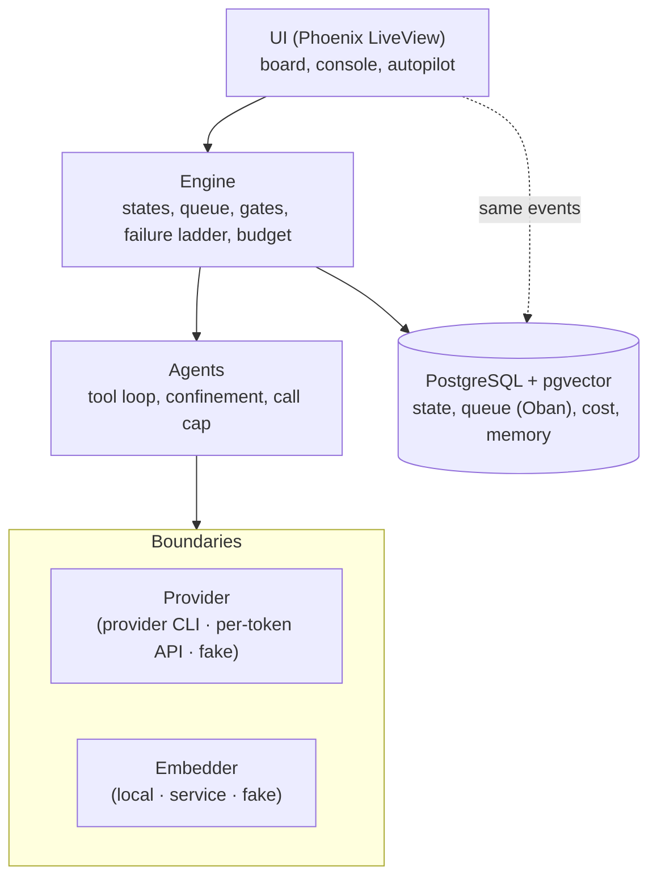
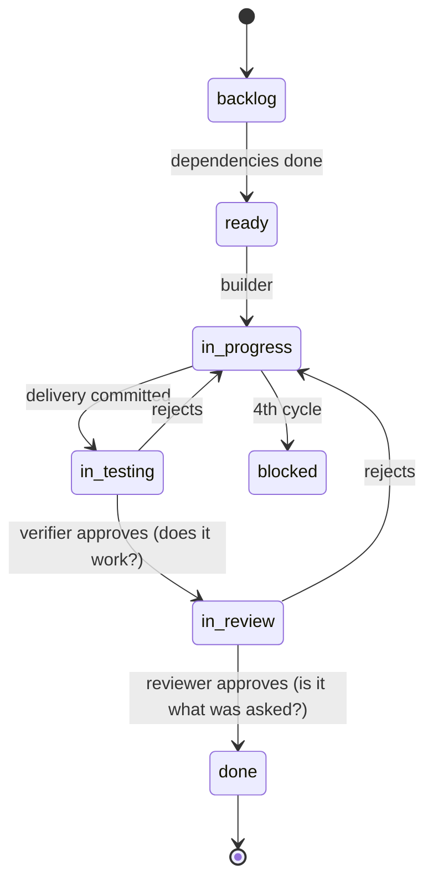

# Architecture

**English** · [Português (BR)](../planejamento/arquitetura.md)

## The core idea

A multi-agent system does not fail because it writes badly, but because it governs badly. The
governance rules leave the text of the prompt and move into the structure of the program, where
they stop being optional.

| The rule | How it usually exists | Where it lives here |
|---|---|---|
| Do not write outside the project | a request in the text | the write tool refuses the path |
| At most three attempts | a reminder that can be ignored | a counter in the database that the agent cannot change |
| Whoever builds does not approve | an agreement between roles | the reviewer gets no write tool |
| Do not blow the budget | a recommendation | the system does not let what does not fit start |

## The four layers

Each layer only knows the one below it. The boundaries (highlighted) make it possible to switch
the model provider or the search without touching the engine.



## The path of a task

The unit of work is the task: small, with acceptance criteria that are commands. Each state
transition is made by an agent other than the one that built it.



## What happens when a task fails

Each rejection changes the strategy. The system counts the cycles, not the agent.

| Cycle | What the system does | Why |
|---|---|---|
| 1st | Redoes it with a stronger model | the rejection is the trigger, not a guess |
| 2nd | Switches the specialist agent | two rejections in a row point to a bias in the approach |
| 3rd | Splits or rewrites the task | the problem may be the size of the task |
| 4th | Blocks it and hands it over to a human | insisting costs money without raising the chance of success |

## Why Elixir

The system does no heavy computation: it waits for slow replies from a remote service, which may
fail. Elixir runs on the Erlang/OTP platform, built to keep many such jobs going at the same time:
each agent is an isolated, supervised process, and one crashing does not affect the others. The
cost of the choice is a smaller AI ecosystem than Python's.

## The stack

| Tool | What it is for |
|---|---|
| Elixir 1.19 / Erlang OTP 28 | language and platform of supervised processes |
| Phoenix 1.8 + LiveView 1.2 | web application and live UI |
| PostgreSQL 18 + Ecto 3.13 | all system state, in one transaction |
| Oban 2.24 | durable queue inside the database |
| pgvector 0.8 | similarity search, in the same database |
| Req 0.5 | talks to the provider's API |
| ExUnit, Credo, Dialyzer | tests, strict style, types |

## Verification, in one command

```
mix factory.ci      # from the cheapest stage to the most expensive; the first failure stops the rest
  1. format    formatting
  2. compile   compilation, any warning fails
  3. lint      Credo in strict mode
  4. test      the whole suite, offline and at no cost
  5. types     Dialyzer
  6. backup    backup round trip, isolated
```
