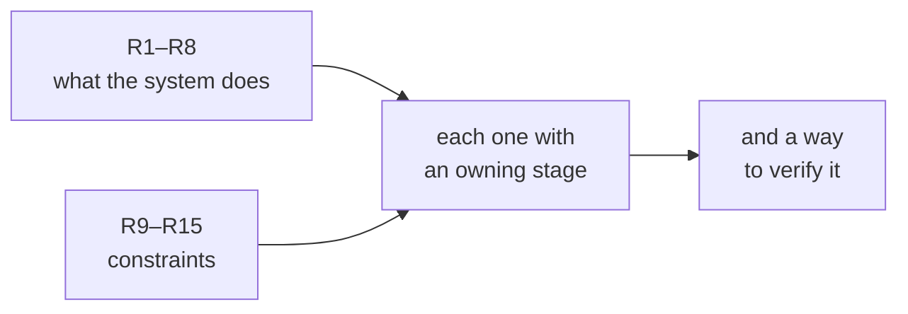

# FAB-101 · Gather requirements R1–R15

> ✅ Done · Stage **E1 — Planning and architecture** · Package 1.1 · Document

## The idea

Write down, before any code, what the system must do and under which constraints — and, for each item, which stage delivers it and how it is proven. Without this, "done" would be an opinion.

## Overview

## What was done

List of what the system must do (8 functional requirements) and the constraints it must work under (7 non-functional ones). Each requirement states the stage that delivers it and how it is verified.

## Why it exists

Without requirements that can be checked objectively, no stage would have a definition of done; they tie each scheduled delivery to something testable.

## How it was built

- R1–R8: request to tasks, six states, two judgements, bounded rework, parallelism, memory and live monitoring
- R9–R15: 8 GB of memory, cost in two units, confinement, offline tests, failure isolation, spending ceiling, swappable provider
- Each row names the owning stage (E2–E7) and the test that proves it

**Example:** R11 — 'no agent writes outside the project folder' — is proven in E3 by tests that try to escape the folder and are refused.

## Acceptance criteria

- [x] 15 requirements written, each with an owning stage
- [x] Each requirement has an objective verification

## How to verify

- `docs/planning/requirements.md`

## Commits

- docs: add requirements R1-R15 (FAB-101)
