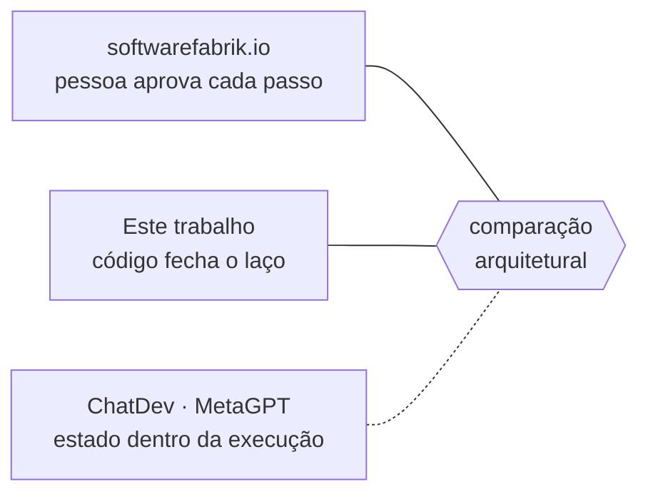

# FAB-102 · Study the state of the art

> ✅ Done · Stage **E1 — Planning and architecture** · Package 1.2 · Document

## The idea

Compare this work with the multi-agent systems that already build software, looking at architecture rather than feature lists, to make the contribution clear.

## Overview

## What was done

Architectural comparison with multi-agent systems that build software, focusing on the closest one, and what this work does differently.

## Why it exists

It draws the line of originality: the contribution is not 'using agents', it is moving governance rules from the prompt into the program's structure.

## How it was built

- Four systems compared by architecture, not by features: ChatDev, MetaGPT, softwarefabrik.io and this work
- Key differences: two gates asking different questions, authority as the absence of a tool, a failure-response ladder

## Acceptance criteria

- [x] Comparison with the main multi-agent systems
- [x] Originality report

## How to verify

- `docs/planejamento/estado-da-arte-resumo.pdf`
- `docs/planejamento/estado-da-arte-completo.pdf`

## Commits

- docs: add state-of-the-art comparison (FAB-102)
