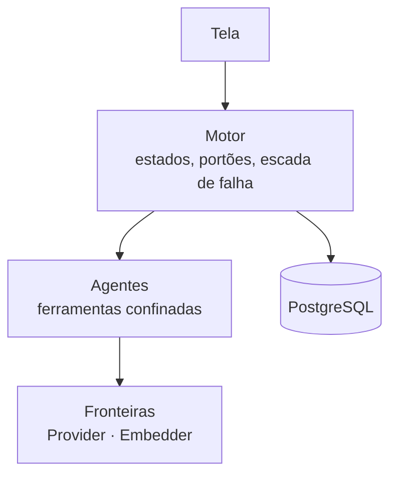

# FAB-103 · Design the architecture

> ✅ Done · Stage **E1 — Planning and architecture** · Package 1.3 · Document

## The idea

Design the system so that every governance rule has a place in the program where it is enforced: the forbidden action does not exist for the agent, instead of merely being requested in the prompt.

## Overview

## What was done

System design: four layers (screen, engine, agents, boundaries), the six-state task lifecycle with two gates, the failure-response ladder and the technology stack.

## Why it exists

The architecture is what makes the rules structural: each rule has a place in the design where it is enforced, not requested.

## How it was built

- Diagrams of the layers and the state machine (Mermaid, rendered on GitHub)
- Table 'rule × where it lives'
- Elixir/OTP chosen for process supervision

## Acceptance criteria

- [x] Diagram of the 4 layers and their boundaries
- [x] Task lifecycle with 6 states and 2 gates
- [x] Stack chosen and justified

## How to verify

- `docs/planejamento/arquitetura.md`

## Commits

- docs: add architecture: layers, task lifecycle and failure ladder (FAB-103)
