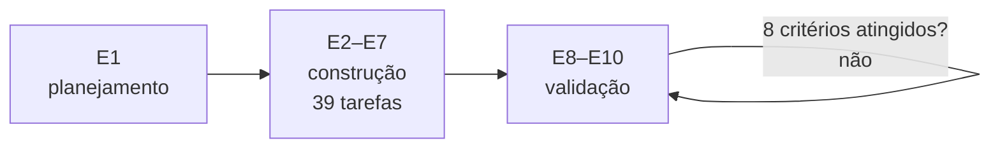

# FAB-104 · Break down the work and define performance criteria

> ✅ Done · Stage **E1 — Planning and architecture** · Package 1.4 · Document

## The idea

Turn the design into an executable plan: stages with a demonstrable delivery, small tasks whose criteria are commands, and a fixed numeric yardstick for validation.

## Overview

## What was done

The development plan (10 waterfall stages), the 8 performance criteria with numeric thresholds and the E2–E7 task board, one task per plan package.

## Why it exists

The criteria are the validation yardstick (E8–E10) and never change; the board turns each stage into small, verifiable deliveries.

## How it was built

- Development plan in Word
- 8 criteria: builds alone, completes tasks, little rework, never approves wrongly, really governs, survives failure, cost under control, fits the machine
- 39 code tasks across E2–E7

## Acceptance criteria

- [x] E2–E7 backlog written (this directory)
- [x] 8 performance criteria with numeric thresholds

## How to verify

- `docs/planejamento/plano-de-desenvolvimento.docx`
- `docs/planejamento/criterios-de-desempenho.md`
- `docs/tasks/`

## Commits

- docs: add development plan, performance criteria and E2-E7 backlog (FAB-104)
