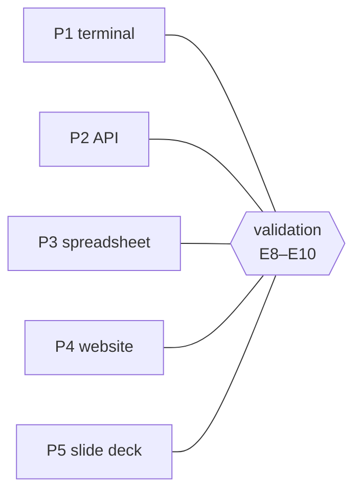

# FAB-105 · Define the five test projects

> 🔄 In progress · Stage **E1 — Planning and architecture** · Package 1.4 · Document

## The idea

Choose, before building, the real projects on which the system will be judged — so the yardstick cannot be tuned to what the system can do.

## Overview

## What was done

Proposal of five real projects, of different sizes and kinds, that validation will run from request to delivery with no human intervention.

## Why it exists

The performance criteria are measured on these projects; choosing them before construction keeps the yardstick from being tuned to the system.

## How it was built

- P1 terminal to-do list · P2 library API · P3 report from a spreadsheet · P4 portfolio site · P5 presentation from data
- Each project has a natural-language request and what counts as delivered

**Example:** Pending: validate the proposal with the advisor.

## Acceptance criteria

- [ ] 5 projects with a natural-language request
- [ ] For each, what counts as delivered

## How to verify

- `docs/planning/test-projects.md`

## Commits

- docs: propose the five test projects (FAB-105)
