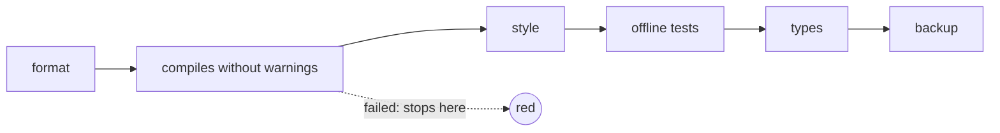

# FAB-201 · Set up the environment and one-command verification

> ✅ Done · Stage **E2 — System foundation** · Package 2.1 · Story · R12

## The idea

One command that tells whether the project is healthy. Instead of remembering several checks, `mix factory.ci` runs them all in order — cheapest first — and stops at the first failure. (`mix` is Elixir's command-line tool, like `npm` or `make`.)

## Overview



## What was done

Creates the Phoenix/Elixir project and a verification battery triggered by a single command, `mix factory.ci`. It runs formatting, warning-free compilation, strict Credo, tests, Dialyzer and the backup test in order, and stops at the first stage that fails.

## Why it exists

Guarantees R12 (automatic, reproducible verification): the system's own definition of 'done' is a command declared in a file, not something remembered.

## How it was built

- Stages are declared in `_management/ci.json` — the file is the source of truth
- `Factory.CI.stages/1` reads the file; `Factory.CI.run/2` applies the 'first failure stops the rest' rule
- `run/2` receives the function that runs a stage, so the rule is testable without real commands
- Fast mode skips expensive stages (Dialyzer) and reports them as SKIPPED instead of omitting them

**Example:** if `mix compile --warnings-as-errors` fails, Credo, tests and Dialyzer never run and the report shows where it stopped.

## Acceptance criteria

- [x] `mix factory.ci` runs every stage, cheapest first
- [x] The first failing stage stops the rest

## How to verify

```bash
mix test test/mix/ci_test.exs
mix factory.ci
```

## Where it lives in the code

`Factory.CI` · `Mix.Tasks.Factory.Ci` · `Factory.Application` · `Factory.Repo`

## Commits

- chore: scaffold the Phoenix application (FAB-201)
- feat(ci): add one-command verification with mix factory.ci (FAB-201)
