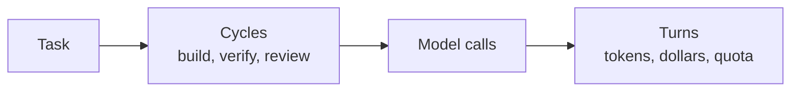

# FAB-202 · Create the database and cost accounting

> ✅ Done · Stage **E2 — System foundation** · Package 2.2 · Story · R10

## The idea

Keep all system state in a relational database (PostgreSQL) and record the cost of every exchange with the AI model, turn by turn. The cost of any task becomes a sum, and the database itself rejects invalid data (such as a made-up status).

## Overview



## What was done

Creates the system's PostgreSQL database: projects, specialists, tasks, dependencies, areas, criteria, cycles, dispatches and per-turn usage. It also adds the price table and the cost arithmetic of each model turn, in two units: subscription quota and estimated dollars.

## Why it exists

Guarantees R10 (measured, queryable cost): the database is the source of truth, and each turn records its usage, so the cost of any cycle is a query, not a guess.

## How it was built

- Six states + two terminal ones in `Factory.Tasks.Task` as an `Ecto.Enum`: an invented status never reaches the database
- `Factory.Tasks.Cycle` is never overwritten: each rework is a new row, so cost per cycle stays separable
- `Factory.Tasks.Usage` stores one row per turn, splitting input, cache read, cache write and output
- `Factory.Cost.Pricing.estimate/2` and `quota_units/2` compute dollars and quota; prices dated by `checked_on/0`
- `Factory.Tasks.Area` stores one file per row, never a directory, so area intersection is exact

**Example:** a turn reading 10k tokens from cache costs 0.1x the input price; a cache write with a 1h TTL costs 2.0x.

## Acceptance criteria

- [x] Migrations create every table
- [x] Each usage row stores tokens, quota and dollar cost
- [x] The cost of a cycle can be queried

## How to verify

```bash
mix test test/factory/schema_test.exs
mix test test/factory/cost/pricing_test.exs
```

## Where it lives in the code

`Factory.Tasks.Task` · `Factory.Tasks.Cycle` · `Factory.Tasks.Dispatch` · `Factory.Tasks.Usage` · `Factory.Tasks.Area` · `Factory.Tasks.Criterion` · `Factory.Tasks.Dependency` · `Factory.Projects.Project` · `Factory.Projects.Specialist` · `Factory.Cost.Pricing` · `Factory.Cost.Usage`

## Commits

- feat(db): add schema for projects, tasks, cycles, dispatches and usage (FAB-202)
- feat(cost): add pricing table and per-turn cost in quota and dollars (FAB-202)
