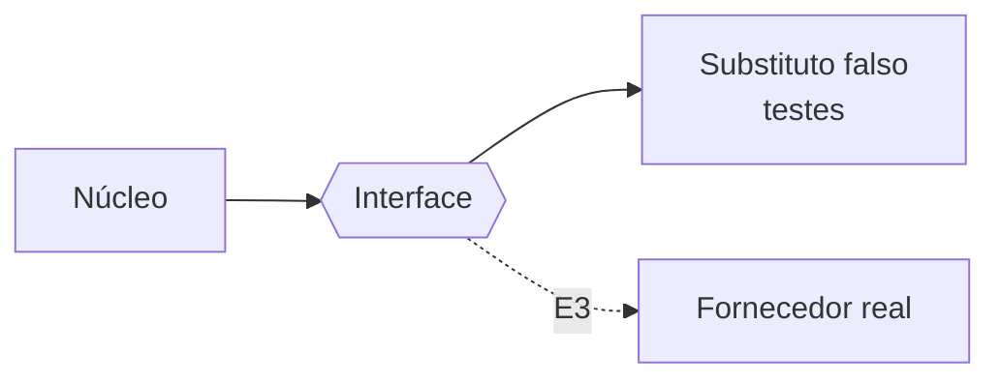

# FAB-203 · Create model and search boundaries, with test doubles

> ✅ Done · Stage **E2 — System foundation** · Package 2.3 · Story · R12, R15

## The idea

The system core does not know the AI model provider: it only knows an interface (a "socket"). Behind it sits, in tests, a fake substitute — free, offline and predictable — and, from E3 on, the real providers. There are two sockets: the Provider (talks to the model) and the Embedder (turns text into a vector of numbers, so memory can search by meaning in E6).

## Overview



## What was done

Defines two boundaries (Elixir behaviours): one for the language-model vendor (`Factory.Provider`) and one for the embedding generator (`Factory.Embedder`). Each comes with a deterministic fake adapter, the default in the test environment.

## Why it exists

Guarantees R12 and R15: all governance lives on this side of the boundary and is tested with no network or cost; switching vendors means switching the adapter without touching the core.

## How it was built

- `Factory.Provider.chat/2` is a single synchronous turn; repeating and counting turns belongs to the agent loop, not the adapter
- `Factory.Provider.Fake` answers from a script declared by the test and returns `{:error, :script_exhausted}` when it runs out — it never invents an answer
- `Factory.Embedder.Fake` produces hash vectors: same text, same vector; different texts, different vectors
- The test configuration points `:provider` and `:embedder` at the fakes

**Example:** a test scripts two responses; the third call gets `{:error, :script_exhausted}` instead of hanging.

## Acceptance criteria

- [x] No test talks to the model provider
- [x] Fake adapters are the default in the test environment

## How to verify

```bash
mix test test/factory/provider/fake_test.exs
mix test test/factory/embedder/fake_test.exs
mix test test/factory/embedder_test.exs
```

## Where it lives in the code

`Factory.Provider` · `Factory.Provider.Fake` · `Factory.Embedder` · `Factory.Embedder.Fake`

## Commits

- feat(provider): add the Provider boundary and its deterministic fake (FAB-203)
- feat(embedder): add the Embedder boundary and its hash-vector fake (FAB-203)
