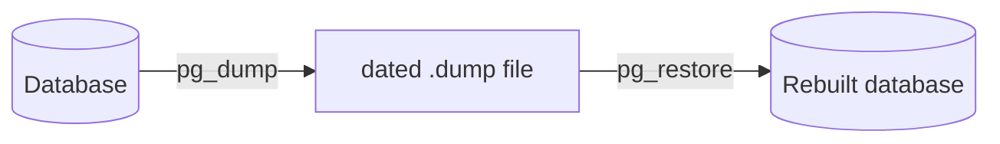

# FAB-204 · Database backup

> ⬜ To do · Stage **E2 — System foundation** · Package 2.4 · Story

## The idea

Be able to copy the whole database and rebuild it, with proof that it works. PostgreSQL ships two tools: `pg_dump` copies the database to a file; `pg_restore` rebuilds the database from it. The test performs the real round trip.

## Overview



## What was done

Adds `mix factory.backup` (writes a database dump) and `mix factory.restore` (restores a dump, including the latest one with `--latest`). The round trip is proved by a test that runs as its own verification stage.

## Why it exists

Since the whole system state lives in the database, not losing work requires a restorable copy; the test ensures the backup is not just a file that looks valid.

## How it was built

- `Factory.Backup.dump/1` and `restore/2` call `pg_dump`/`pg_restore` in custom format
- Binary location comes from `config :factory, :pg_bin`, never the PATH: a wrong-version client produces a dump that fails only on restore
- Restore uses `--clean --if-exists`, so it is repeatable
- The test runs isolated as the `backup` stage (`mix test.backup`), outside the regular suite

**Example:** writes data, dumps, deletes, restores and checks the data came back identical.

## Acceptance criteria

- [ ] Backup and restore preserve the data
- [ ] The round-trip test runs isolated from the rest of the suite

## How to verify

```bash
mix test.backup
```

## Where it lives in the code

`Factory.Backup` · `Mix.Tasks.Factory.Backup` · `Mix.Tasks.Factory.Restore`
