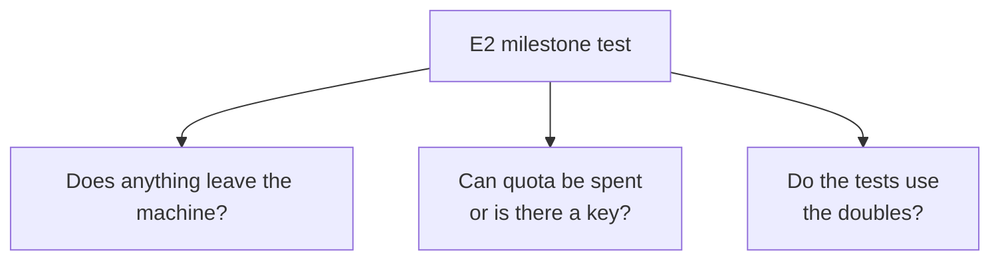

# FAB-205 · MILESTONE E2 — the suite runs offline and without quota

> ✅ Done · Stage **E2 — System foundation** · Package Marco · Milestone · R12

## The idea

An automated test file (`test/factory/milestone_e2_test.exs`) whose job is to prove the stage deliverable: tests run offline and without consuming the model service. It runs on every verification — if anyone opens a path to the internet or to a secret, it fails.

## Overview



## What was done

Stage 2 milestone: a permanent test proving the whole suite runs with no network, no quota and no API key. It is not run once — it runs on every verification, so the milestone does not become false with the next dependency.

## Why it exists

Guarantees R12: testing governance must not spend money or depend on the vendor; if someone adds an HTTP client or reads a key in the wrong place, the suite breaks.

## How it was built

- Every HTTP request goes through a gatekeeper that raises in tests; the test tries to call the real API and checks the error
- No other network library is loaded and no code opens a raw connection
- No code reads environment variables or names the access key; no file contains anything shaped like a key
- Key variables do not exist in the test environment
- The configured Provider and Embedder are the fakes; no local model library is loaded

**Example:** a `Req.get!` to `api.anthropic.com` during the suite raises 'tried to LEAVE during the test suite'.

## Acceptance criteria

- [x] `mix test test/factory/milestone_e2_test.exs` passes
- [x] Runs on every verification, not only on milestone day

## How to verify

```bash
mix test test/factory/milestone_e2_test.exs
```

## Where it lives in the code

`Factory.MilestoneE2Test` · `Factory.NoNetwork`

## Commits

- test: prove the suite runs with no network, quota or API key (FAB-205)
