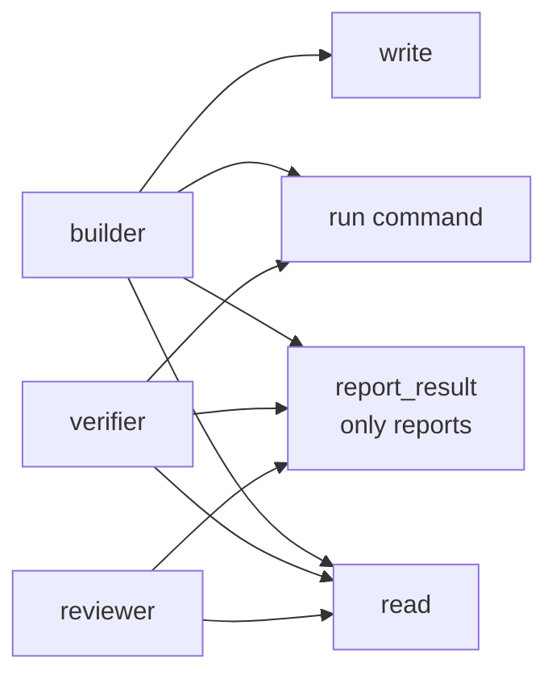

# FAB-301 · File and command tools

> ⬜ To do · Stage **E3 — The agent and its tools** · Package 3.1 · Story

## The idea

Give the agent its "hands": tools to read, list, search, write and edit files and to run commands. The system always does the executing. Each role receives only the tools it needs, and none receives a tool to change the task state — the agent only reports what it did.

## Overview



## What was done

Creates the tools the agent uses: read, list, search, write and edit files, and run external commands with a timeout. When the timeout expires, the system kills the whole process tree, not just the launched process. Includes the per-role tool catalog and the `report_result` tool.

## Why it exists

Governance shows up as an absence: no role gets a tool that changes task status or attempts, and verifier and reviewer get no write tool. The agent only reports; the system changes state.

## How it was built

- `Factory.Tools.Command` uses a `Port` with `:spawn_executable` (exposes the OS pid) and returns stdout and stderr separately
- `Factory.Tools.ProcessTree.kill/1` uses `taskkill /T /F` on Windows and a process-group signal on Unix
- `Factory.Tools.Files.edit/4` is an exact replacement: refused if the target appears zero or several times
- `Factory.Tools.Catalog.for_role/1` sets each role's tools; a test fails if any can write state
- `Factory.Tools.ReportResult` drops fields outside the allowlist and warns in the same response

**Example:** a `mix test` hanging past the timeout is killed together with its child `erl`, and the result carries reason `:timeout`, not a failed test.

## Acceptance criteria

- [ ] A command past its deadline is killed with all its children
- [ ] stdout and stderr arrive separate and complete
- [ ] The agent records its result without being able to change the task state

## How to verify

```bash
mix test test/factory/tools/command_test.exs
mix test test/factory/tools/files_test.exs
mix test test/factory/tools/report_result_test.exs
```

## Where it lives in the code

`Factory.Tools.Files` · `Factory.Tools.Command` · `Factory.Tools.ProcessTree` · `Factory.Tools.Catalog` · `Factory.Tools.ReportResult`
