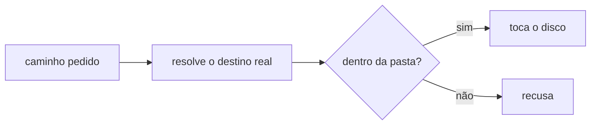

# FAB-302 · Confinement: no agent writes outside the project

> ⬜ To do · Stage **E3 — The agent and its tools** · Package 3.2 · Story · R11

## The idea

Guarantee that no agent writes outside the project folder. Before touching the disk, every path is resolved to its real target — following links and junctions — and refused if it leaves the folder. It is not a request in the prompt: it is a rule in the code, and the agent's shell also runs inside an operating-system sandbox.

## Overview



## What was done

Implements confinement: no file tool can read or write outside the project folder. Every path is resolved to its real target and refused if it is absolute, contains `..`, a link or junction pointing outside, a UNC path or a Windows device. It also adds guards that judge a command before it runs.

## Why it exists

Guarantees R11 (the agent never leaves the project) as a property of the code, not a sentence in the prompt.

## How it was built

- `Factory.Tools.Confinement.resolve/2` normalizes, follows links to the real target and compares with the root before touching the disk
- Backslash is a separator on every platform; case-insensitive comparison on Windows, case-sensitive elsewhere
- `Factory.Tools.Guards.check_process/2` REFUSES commands that would kill the factory itself; `check_tooling/1` only WARNS about reinvented wheels
- Guards are pure functions, exhaustively testable
- In the CLI adapter the agent's shell runs in an OS sandbox (without the sandbox, an agent with a shell does not start); `priv/probes/confinement_cli.exs` proves against the real binary that the CLI refuses to write outside the root

**Example:** a `../../etc/passwd` or `CON` path is refused with an error before any read or write.

## Acceptance criteria

- [ ] A path outside the root is rejected before touching the disk
- [ ] Links and junctions are followed to their real target
- [ ] Without a sandbox, an agent with a shell does not start

## How to verify

```bash
mix test test/factory/tools/confinement_test.exs
mix test test/factory/tools/guards_test.exs
mix factory.syntax priv/probes/confinement_cli.exs
```

## Where it lives in the code

`Factory.Tools.Confinement` · `Factory.Tools.Guards`
