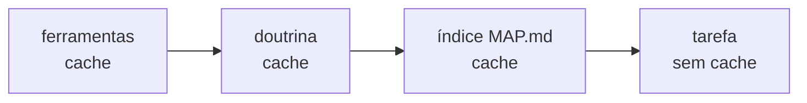

# FAB-303 · Project summary to guide the agent

> ⬜ To do · Stage **E3 — The agent and its tools** · Package 3.1 · Story

## The idea

Give the agent a project summary so it can find its way without reading all the code: an index with the file tree and each module's public functions. And build the fixed part of the request to the model identically, byte for byte, so the provider can reuse its cache and charge less.

## Overview



## What was done

Generates a dense project index (`_management/MAP.md`): file tree, public symbols and the purpose of each, so the agent can orient itself without reading all the code. It also assembles the stable part of the prompt in fixed bands, with one cache breakpoint per band.

## Why it exists

Cuts context and cost per dispatch: the vendor cache only turns into cheap reads if the prefix is byte-for-byte identical across dispatches.

## How it was built

- `Factory.Index.CodeMap.extract/1` uses the AST (`Code.string_to_quoted/2`), never regexes
- Output has no date, hash or counter: two generations over the same tree give identical bytes
- `Factory.Prompt.Prefix.build/2` orders the bands: tools → doctrine → index (cached) → task (not cached)
- Warns when the prefix is below the model's minimum cacheable size (512/1024/4096 tokens)
- `mix factory.map` writes the index

**Example:** running `mix factory.map` twice without code changes produces the same file, so the prefix stays cached.

## Acceptance criteria

- [ ] `mix factory.map` generates the index deterministically
- [ ] The prefix has stable bands and one cache breakpoint per band

## How to verify

```bash
mix test test/factory/index/code_map_test.exs
mix test test/factory/prompt/prefix_test.exs
mix factory.map
```

## Where it lives in the code

`Factory.Index.CodeMap` · `Factory.Prompt.Prefix` · `Factory.Prompt.Block` · `Mix.Tasks.Factory.Map`
