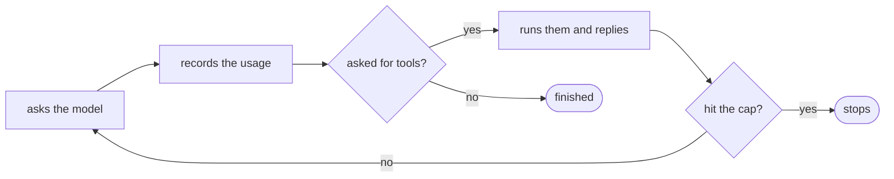

# FAB-304 · The agent as a supervised process, with a call limit

> ⬜ To do · Stage **E3 — The agent and its tools** · Package 3.3 · Story

## The idea

Build the heart of the agent: a loop that asks the model, runs the requested tools, returns the results and repeats until the model is done. The limits (number of turns and spending) live in the process itself, so the model cannot ignore them — and the cost of each turn is recorded before going on.

## Overview



## What was done

Implements the agent core: the loop that builds the request, calls the model, runs the requested tools and repeats until the model is done or a cap is hit. The loop is an OTP process (GenServer) that can be supervised and stopped from outside.

## Why it exists

Turn and spend caps live in process state, not in the prompt: the model does not decide whether to continue, so it cannot ignore the limit.

## How it was built

- `Factory.Agents.Loop.run/1` returns all tool results in a single turn
- A failing tool returns `error: true` instead of disappearing
- Each turn records usage BEFORE deciding to continue, including errors that already spent tokens
- `Factory.Agents.State.check_continue/1` enforces the caps; `Factory.Agents.ToolBudget` measures calls per role (target and p90 threshold)
- `ToolBudget` measures and never cuts: interrupting mid-way costs the same and delivers nothing

**Example:** with a 30-turn cap, turn 31 never happens even if the model asks for another tool.

## Acceptance criteria

- [ ] Each turn stores one usage row
- [ ] The per-role call ceiling is enforced
- [ ] The project root reaches the runner on every turn

## How to verify

```bash
mix test test/factory/agents/loop_test.exs
mix test test/factory/agents/tool_budget_test.exs
```

## Where it lives in the code

`Factory.Agents.Loop` · `Factory.Agents.State` · `Factory.Agents.ToolBudget`
