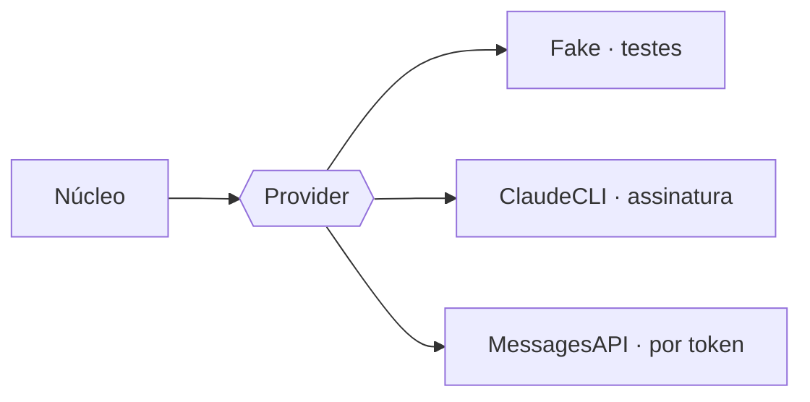

# FAB-305 · Provider adapters, with control measured first

> ⬜ To do · Stage **E3 — The agent and its tools** · Package 3.4 · Story · R15

## The idea

Plug real providers into the socket created in E2: one that drives the provider's command-line program (uses the subscription) and one that talks directly to the API (pays per token and controls the cache). The core does not change. The safety rules for the command-line program were measured against the real program before being decided.

## Overview



## What was done

Creates two real adapters behind the same `Factory.Provider` boundary: one that drives the Claude Code CLI (runs on the subscription, spends quota) and one that talks HTTP directly to the Messages API (pays per token, with cache control). The CLI's governance rules were measured against the real binary before deciding.

## Why it exists

Guarantees R15 (vendor independence): switching adapters does not change the core, and governance is enforced on the command line and audited in the output.

## How it was built

- `Factory.Provider.ClaudeCLI` uses `--permission-mode acceptEdits` and closes the vocabulary with `--tools`
- Shell only with a mandatory OS sandbox; unavailable → `{:error, :sandbox_unavailable}`
- `ClaudeCLI.parse/2` audits every `tool_use` path through `Confinement.resolve/2` and recognises the quota wall
- `Factory.Provider.MessagesAPI` uses plain `Req` and puts `cache_control` with a 1h TTL on the last block of each stable band
- Probes in `priv/probes/` (`cli_governance.exs`, `cli_real.exs`) measure the real binary's behaviour

**Example:** if the CLI wrote a file outside the root, the response becomes `{:error, {:outside_confinement, paths}}`, with the already-paid usage recorded.

## Acceptance criteria

- [ ] Switching adapters does not change the core
- [ ] CLI permissions, tool vocabulary and turn ceiling are applied
- [ ] The real dispatch cost matches the provider's

## How to verify

```bash
mix test test/factory/provider/claude_cli_test.exs
mix test test/factory/provider/messages_api_test.exs
mix factory.syntax priv/probes/cli_governance.exs
mix factory.syntax priv/probes/cli_real.exs
```

## Where it lives in the code

`Factory.Provider.ClaudeCLI` · `Factory.Provider.MessagesAPI`
