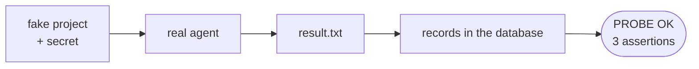

# FAB-306 · MILESTONE E3 — a real agent solves a real task, with cost recorded

> ✅ Done · Stage **E3 — The agent and its tools** · Package Marco · Milestone · R15

## The idea

Prove the stage delivery against the real model: a real agent gets a real task in a throwaway project — create a file with a secret generated on the spot — and solves it. The script then checks that the cost was stored in the database, one row per turn, with the totals matching.

## Overview



## What was done

Stage 3 milestone: a script (probe) that runs an agent against the REAL model, in a fake project, asking it to create a file with a secret content. It then checks that the task was solved and that cost was recorded correctly in the database.

## Why it exists

Guarantees R15 and R10 with the real vendor: the loop, the CLI adapter and per-turn accounting work together outside the simulated tests.

## How it was built

- 1. Creates a temporary folder with 3 files and a unique secret generated on the spot
- 2. Runs `Factory.Agents.Loop` with `Provider.ClaudeCLI` and only the `write` tool (no sandbox dependency)
- 3. Stores the cycle, the dispatch and one usage row per turn in a single transaction (`Ecto.Multi`)
- 4. Claim 1: `result.txt` exists on disk and contains the requested secret
- 5. Claims 2 and 3: one `usages` row per turn, and the token sum in the database equals the sum in the loop state; prints PROBE OK

**Example:** it spends subscription quota, so it is a manual probe and not part of `mix test`.

## Acceptance criteria

- [x] `mix run priv/probes/milestone_e3_agent.exs` prints PROBE OK
- [x] All three assertions pass: task solved, one row per turn, totals match

## How to verify

```bash
mix factory.syntax priv/probes/milestone_e3_agent.exs
mix run priv/probes/milestone_e3_agent.exs
```

## Where it lives in the code

`Factory.Agents.Loop` · `Factory.Provider.ClaudeCLI` · `Factory.Tasks.Transition`

## Commits

- test: add the E3 milestone probe against the real model (FAB-306)
