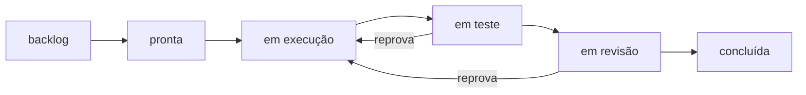

# FAB-401 · The six states, with each change stored atomically

> ⬜ To do · Stage **E4 — Task production line** · Package 4.1 · Story · R2

## The idea

Give every task the same line of states — backlog, ready, in progress, testing, review, done — and make each change store the state, the report and the cost together. Either everything is written or nothing is; and the attempts counter belongs to the system, never to the agent.

## Overview



## What was done

Implements the task state machine (backlog → ready → in progress → testing → review → done, plus blocked and cancelled) and the transactional transition. Changing state writes, in a single transaction, the new state, the cycle report, the dispatch and the usage — or nothing.

## Why it exists

Guarantees R2 (fixed-state lifecycle): no code path writes a status without checking the rule, and the attempts counter is incremented by the system, never by the agent.

## How it was built

- `Factory.Tasks.StateMachine` is pure: `can?/2`, `check/2`, `targets/1` over the map of legal transitions
- `Factory.Tasks.Transition.apply/3` builds an `Ecto.Multi` with status, cycle, dispatch and N usage rows
- Entering `in_progress` increments `attempts` in the same transaction (`hands_to_builder?/1`)
- The task row is read `FOR UPDATE`, so concurrent transitions on the same task serialize

**Example:** `done → in_progress` is refused: undoing approved work requires a new task.

## Acceptance criteria

- [ ] An invalid transition is rejected
- [ ] State, cycle, dispatch and usage stored in one transaction
- [ ] The attempt counter belongs to the system

## How to verify

```bash
mix test test/factory/tasks/state_machine_test.exs
mix test test/factory/tasks/transition_test.exs
```

## Where it lives in the code

`Factory.Tasks.StateMachine` · `Factory.Tasks.Transition`
