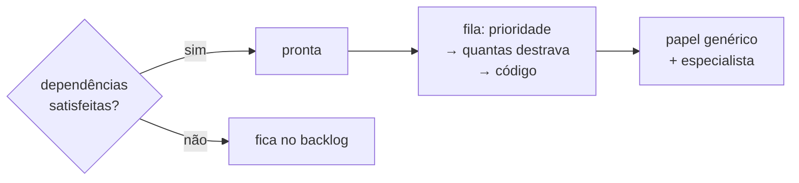

# FAB-402 · Dependency queue and specialist team

> ⬜ To do · Stage **E4 — Task production line** · Package 4.2 · Story

## The idea

Decide by rule, not by guess, when a task may start (every dependency satisfied) and which goes first (the one that unblocks the most work). And decide who builds it: the generic role, plus a specialist when the task points to one.

## Overview



## What was done

Creates the scheduler: decides which tasks become 'ready' (every dependency done) and in which order the queue is dispatched. Also creates the versioned team of specialists and the rule deciding who builds each task: the generic role plus, optionally, a specialist.

## Why it exists

Takes away from the model decisions that fit in a test (promotion and order), and keeps the role's discipline always present, with the specialist only adding domain knowledge.

## How it was built

- `Factory.Tasks.Scheduler.promote/1`: a cancelled dependency counts only if every replacement is satisfied; a blocked one never counts
- `Scheduler.next_steps/2` orders by priority, then by how many open tasks each unblocks, then by code
- `Factory.Team.define/2` deactivates the old version and inserts the new one in one transaction (partial unique index `where: active`)
- `Factory.Team.Resolution.resolve/3` has two outcomes: role alone or role + specialist; an unknown specialist is recorded as a defect

**Example:** on a priority tie, the task that unblocks three others goes before one that unblocks none.

## Acceptance criteria

- [ ] A task becomes ready only when all dependencies are done
- [ ] Queue ties: the task that unblocks most goes first
- [ ] The specialist adds to the role, it does not replace it

## How to verify

```bash
mix test test/factory/tasks/scheduler_test.exs
mix test test/factory/team/resolution_test.exs
```

## Where it lives in the code

`Factory.Tasks.Scheduler` · `Factory.Team` · `Factory.Team.Resolution`
