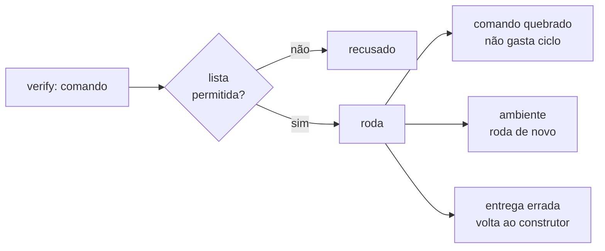

# FAB-403 · Acceptance criteria executed automatically

> ✅ Done · Stage **E4 — Task production line** · Package 4.3 · Story

## The idea

Run by itself, before calling any agent, every criterion that has a command — only from an allowlist — and say whose fault it is when it fails: the command's, the machine's or the delivery's.

## Overview



## What was done

Runs on its own, before spending an agent dispatch, every acceptance criterion that has a command (`verify:`). It only runs binaries from an allowlist and classifies each failure: broken command, environment problem or wrong delivery. The project's test suite is always added as an implicit criterion.

## Why it exists

Separates 'the command is wrong' from 'the delivery is wrong': otherwise the builder — who may not change criteria — would be dispatched again to fix something already right, burning cycles.

## How it was built

- `Factory.Criteria.run/3` executes; repeated commands run once and the second becomes a mirror
- `Factory.Criteria.Allowlist.check/1` is an allowlist (fails closed): `git` read-only, `npx` excluded
- `Factory.Criteria.FailureClass.classify/1`: `:broken_tool` and `:environment` spend no cycle; `:delivery` does; when in doubt, `:delivery`
- `Factory.Criteria.Suite` takes the test command from `_management/ci.json` or detects it by ecosystem (`Factory.Ecosystems`)
- The report labels each criterion and closes with a `Proof levels:` line

**Example:** a `git push` criterion is refused without running; a `mix test` whose target file does not exist counts as a failed delivery.

## Acceptance criteria

- [x] Only allow-listed binaries run
- [x] An environment failure does not count as a rejected delivery
- [x] The project test suite is an implicit criterion

## How to verify

```bash
mix test test/factory/criteria_test.exs
mix test test/factory/criteria/failure_class_test.exs
mix test test/factory/criteria/suite_test.exs
```

## Where it lives in the code

`Factory.Criteria` · `Factory.Criteria.Allowlist` · `Factory.Criteria.FailureClass` · `Factory.Criteria.Suite` · `Factory.Ecosystems`

## Commits

- feat(criteria): run executable acceptance criteria behind a command allowlist (FAB-403)
- test(criteria): cover failure classes and the implicit suite per ecosystem (FAB-403)
