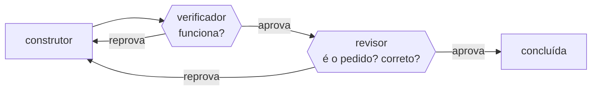

# FAB-404 · The two gates

> ✅ Done · Stage **E4 — Task production line** · Package 4.4 · Story · R3

## The idea

Split two questions into two gates that write nothing: the verifier asks "does it work?"; the reviewer asks "is it what was asked?" and "is it correct?". Whoever builds never approves.

## Overview



## What was done

Creates the two gates every delivery goes through: the verifier ('does it work?', running the criteria) and the reviewer ('is it what was asked?' and 'is it correct?', reading the diff). Neither gets a write tool.

## Why it exists

Guarantees R3 (two independent gates): a gate that can fix what it rejects is no longer a gate, and conformance is judged separately from defects.

## How it was built

- `Factory.Gates.Verifier.judge/1` approves only if no criterion failed; `:inconclusive` blocks — 'I don't know' never becomes 'yes'
- `Factory.Gates.Reviewer.judge/2` rejects on nonconformance even with zero findings
- Findings use `[severity] file:line — problem`, read by `parse_findings/1`
- The reviewer module cannot read the disk (a test scans its source); it only receives the committed diff

**Example:** a delivery passing every criterion but implementing something else comes out 'nonconforming, zero findings' and goes back to execution.

## Acceptance criteria

- [x] The two gates reject for different reasons
- [x] A conformance rejection needs no defect
- [x] Reviewer findings reject even when recorded through the result tool

## How to verify

```bash
mix test test/factory/gates_test.exs
mix test test/factory/gates/reviewer_test.exs
```

## Where it lives in the code

`Factory.Gates.Verifier` · `Factory.Gates.Reviewer`

## Commits

- feat(gates): add the verifier and reviewer gates with the conformance verdict (FAB-404)
