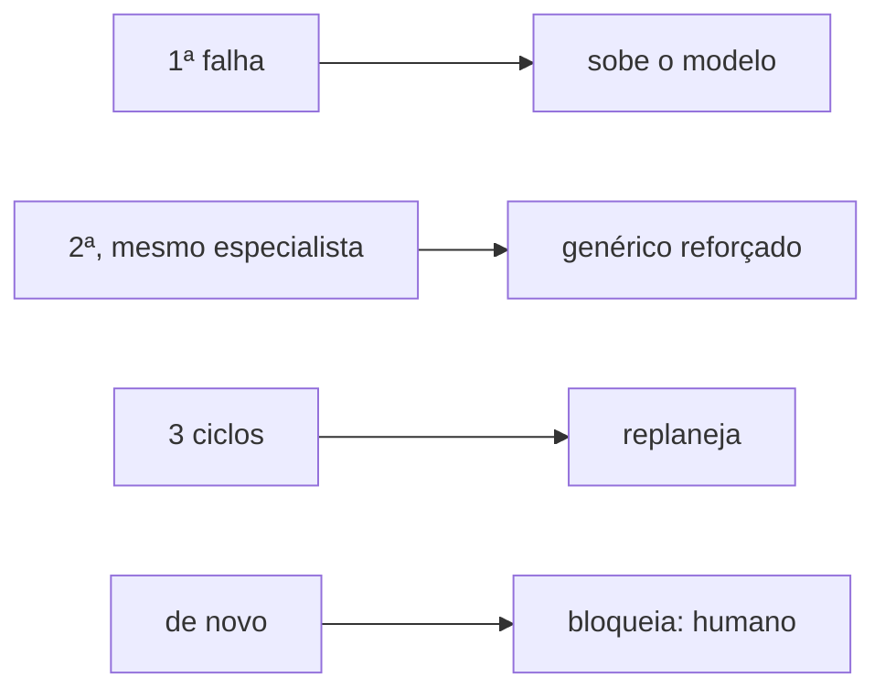

# FAB-405 · Rejection diagnosis and response ladder

> ⬜ To do · Stage **E4 — Task production line** · Package 4.5 · Story · R4, R5

## The idea

When a task is rejected, decide HOW to redo it: a stronger model, another builder, replanning or the human — and how big the rework is. Each cycle changes strategy, and rework comes to an end.

## Overview



## What was done

Decides HOW to redo a rejected task, not just that it must be redone. A four-step ladder picks the response (stronger model, different specialist, replan, block for the human) and a diagnosis sets the size of the rework (scope, number of turns, focus).

## Why it exists

Guarantees R4 and R5 (cycle limit and self-correction): each cycle changes strategy based on a recorded fact (the attempts counter), and an impossible task does not spawn replacements forever.

## How it was built

- `Factory.Rework.Ladder.next_step/1`: 1st failure escalates the model; 2nd under the same specialist switches to the generic reinforced builder; 3 cycles → replan; again → block
- A cap of 12 dispatches per task per round as defence in depth
- `Factory.Rework.Diagnosis.diagnose/2` classifies the failure: blocker, conformance, functional or localized
- `Factory.Rework.Policy`: narrow 8 turns, medium 18, wide 30

**Example:** a minor finding with a named file and line yields an 8-turn rework on those files only, not a reimplementation.

## Acceptance criteria

- [ ] Each cycle changes the strategy
- [ ] The model is upgraded on the 2nd cycle
- [ ] After 3 cycles it replans; if already replanned, it blocks for a human

## How to verify

```bash
mix test test/factory/rework/ladder_test.exs
mix test test/factory/rework/diagnosis_test.exs
```

## Where it lives in the code

`Factory.Rework.Ladder` · `Factory.Rework.Diagnosis` · `Factory.Rework.Policy`
