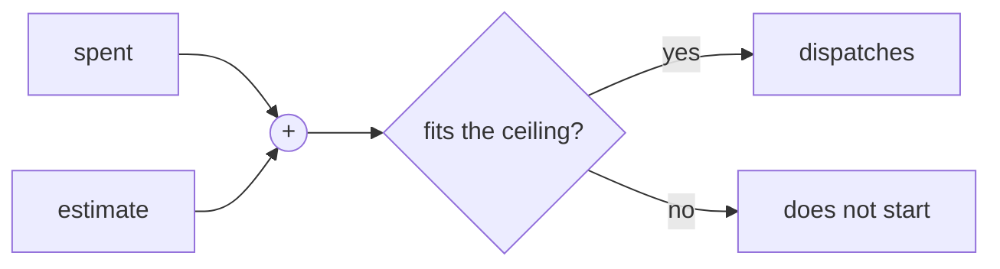

# FAB-406 · Spending ceiling per round and per task

> ✅ Done · Stage **E4 — Task production line** · Package 4.5 · Story · R14

## The idea

Before starting the next task, check whether spending plus the estimate fit the ceiling. If they do not, it does not start — and nothing already running is cut midway.

## Overview



## What was done

Implements the spending ceiling: per round and per task. Before dispatching, the system checks whether accumulated spend plus the estimate of the next piece of work fits the cap; if not, it does not start. Work in progress is never interrupted.

## Why it exists

Guarantees R14 (bounded spend): interrupting an agent mid-way costs the same and delivers nothing, so the only control is not STARTING what does not fit.

## How it was built

- `Factory.Budget.check_round/3` compares spend + estimate with the round cap
- `Factory.Budget.task_cap/2` is a fraction of the round cap; `check_task/2` prevents redispatching the same task
- `estimate_next_task/1` calibrates from the mean cost per COMPLETED task in the same job, with a declared default when unmeasured
- Pure module: no function can see a dispatch in flight

**Example:** with a US$ 20 cap, US$ 15 spent and a US$ 7.82 estimate, the next task is not started.

## Acceptance criteria

- [x] A dispatch that does not fit does not start
- [x] Work in progress is never interrupted by the ceiling

## How to verify

```bash
mix test test/factory/budget_test.exs
```

## Where it lives in the code

`Factory.Budget`

## Commits

- feat(budget): add the spending ceiling checked before each dispatch (FAB-406)
