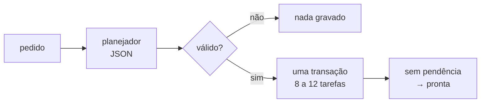

# FAB-407 · From request to tasks: the planner

> ✅ Done · Stage **E4 — Task production line** · Package R1 · Story · R1

## The idea

Turn a natural-language request into a graph of 8 to 12 tasks, checked before writing and written all at once. It is the system's only human entry point.

## Overview



## What was done

Creates the planner: turns a natural-language request into a graph of 8 to 12 tasks, with areas, criteria and dependencies, written to the database in one transaction; at the end, tasks with nothing pending become ready. `mix factory.plan` is the system's only human entry point. Separately, it creates publishing: each task's markdown, identical byte for byte, and a commit restricted to the task's areas.

## Why it exists

Guarantees R1 (from request to tasks without intervention): an invalid plan is refused before touching the database, and there is never a partial plan.

## How it was built

- `Factory.Planner.plan/3` extracts the JSON block from the agent's last message (format in `priv/doctrine/planner.md`)
- Refuses missing JSON, a count outside 8..12, an area ending in `/` or a dependency cycle
- The `T-NNN` code is assigned by the system, like status and attempts
- `Factory.Publishing.Markdown.generate/1` is byte-for-byte deterministic (sorted lists, no generation date)
- `Factory.Publishing.Git.commit/3` commits only the areas + the task file and refuses if anything changed outside them (module ready and tested; `mix factory.plan` writes to the database and does not publish)

**Example:** a request producing a plan with a circular dependency is refused and no row is written.

## Acceptance criteria

- [x] `mix factory.plan` produces valid tasks from a request
- [x] Each task can be published as deterministic markdown and committed with its areas only

## How to verify

```bash
mix test test/factory/planner_test.exs
mix test test/factory/publishing/markdown_test.exs
mix test test/factory/publishing/git_test.exs
mix test test/mix/plan_test.exs
```

## Where it lives in the code

`Factory.Planner` · `Factory.Publishing.Markdown` · `Factory.Publishing.Git` · `Factory.Projects.Phase` · `Factory.Projects.Milestone` · `Mix.Tasks.Factory.Plan`

## Commits

- feat(db): add the phases and milestones schema (FAB-407)
- feat(planner): turn a request into a validated task graph in one transaction (FAB-407)
- feat(publishing): publish the plan as markdown and commit it with git (FAB-407)
- feat(planner): add mix factory.plan as the single human entry point (FAB-407)
