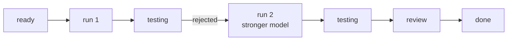

# FAB-408 · MILESTONE E4 — rejected on purpose, reworked and done

> ✅ Done · Stage **E4 — Task production line** · Package Milestone · Milestone · R2, R3, R4

## The idea

Prove the whole line in a permanent test: a task is rejected on purpose for a wrong delivery, gets a stronger model, is reworked and completes — with each step and each cycle's cost recorded.

## Overview



## What was done

Stage 4 milestone: a permanent test in which a task goes down the line from ready to done, is rejected on purpose for a wrong delivery, is reworked on a stronger model and completes. Everything is recorded by transactional transitions, with no real agent or network.

## Why it exists

Proves R2, R3 and R4 together: fixed states, a gate that really rejects and a rework ladder that changes strategy.

## How it was built

- 1. The task starts in `ready` (backlog would need dependencies, proven in the scheduler tests); `→ in_progress`: `attempts` becomes 1; the builder delivers (`→ in_testing`) without spending an attempt
- 2. The verifier rejects: the criterion required the exact message 'invalid message: required field' and got 'invalid' (`→ in_progress`, `attempts` = 2)
- 3. `Factory.Rework.Ladder.next_step/1` answers `:escalate_model`, and the cycle-2 model differs from cycle 1
- 4. Cycle 2: testing approves (`→ in_review`), reviewer approves (`→ done`)
- 5. Checks the history ready → in progress → testing → in progress → testing → review → done, one builder dispatch per attempt, each cycle's cost queryable separately and the task markdown with both cycles

**Example:** the test fails if the rework model is the same as the first attempt's.

## Acceptance criteria

- [x] `mix test test/factory/milestone_e4_test.exs` passes
- [x] History: ready → in progress → testing → in progress → testing → review → done
- [x] Cost per cycle can be queried separately

## How to verify

```bash
mix test test/factory/milestone_e4_test.exs
```

## Where it lives in the code

`Factory.Tasks.Transition` · `Factory.Rework.Ladder` · `Factory.Cost.Pricing` · `Factory.Publishing.Markdown`

## Commits

- test: prove the six states, a rejection and a stronger rework end in done (FAB-408)
