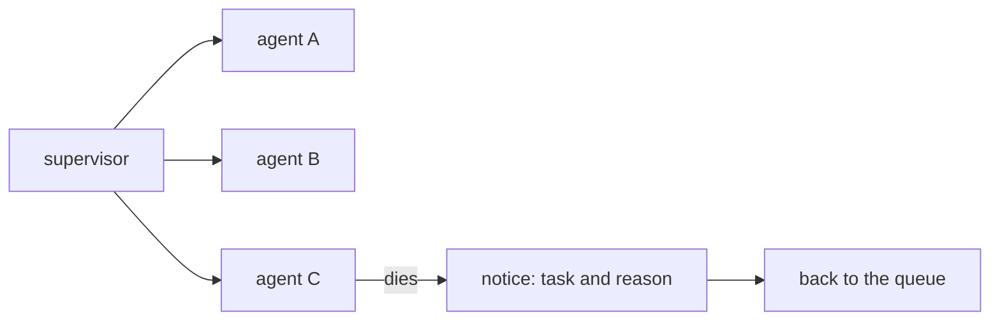

# FAB-501 · One supervised process per task

> ⬜ To do · Stage **E5 — Parallelism and fault tolerance** · Package 5.1 · Story · R13

## The idea

Each agent runs in its own process, with an address and a supervisor that notices when it dies. If one crashes the others never notice — and no work is lost, because it lives in the database.

## Overview



## What was done

Creates the supervision tree for running agents: each agent is an isolated Erlang process, with an address (`{:agent, task_id}` in a Registry) and a dynamic supervisor. One agent's death does not affect the others and is detected immediately.

## Why it exists

Guarantees R13 (fault tolerance): work state lives in the database, not in the process, so an agent can die at any time without losing anything.

## How it was built

- `Factory.Agents.Supervisor.start_agent/4` under a `:one_for_one` `DynamicSupervisor`
- Children use `restart: :temporary`: a blind restart would create an agent with no memory of the conversation and pay again
- Deaths are detected via `Process.monitor/1` (catches even `:kill`), calling `on_crash(task_id, reason)`
- `list/0` and `stop_agent/1` query and stop through the Registry

**Example:** killing task 7's agent process leaves the agents of tasks 5 and 6 untouched, and the caller receives the death reason.

## Acceptance criteria

- [ ] Each agent is an isolated, supervised process
- [ ] Running agents can be listed through the registry

## How to verify

```bash
mix test test/factory/agents/supervisor_test.exs
```

## Where it lives in the code

`Factory.Agents.Supervisor`
