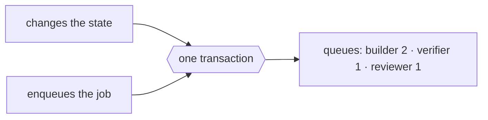

# FAB-502 · Durable queue in the database

> ⬜ To do · Stage **E5 — Parallelism and fault tolerance** · Package 5.2 · Story

## The idea

Pending work lives in a queue inside the database itself, written together with the task's state change: both exist or neither does. A crash erases nothing.

## Overview



## What was done

Creates the durable work queue using Oban on the same PostgreSQL. Enqueueing a task's next step and changing its state happen in the same transaction, and queued work survives restarts. The queue worker is what starts the agent and applies the role's judgement.

## Why it exists

Prevents the impossible state 'in progress with nobody running it': either the job and the state change exist together, or neither does.

## How it was built

- `Factory.Queue.Worker.dispatch/3` grafts `Transition.append/4` into an `Ecto.Multi` that also inserts the `Oban.Job`
- Jobs unique per `{task_id, role}`; `max_attempts: 1` because retrying belongs to the rework ladder
- Exception: a quota wall or unavailable sandbox reschedules the same job (`{:snooze, s}`) without spending an attempt
- `Factory.Queue.Rescue` moves jobs stuck in `executing` after a node crash back to `available`

**Example:** if the node dies mid-run, the stuck job returns to the queue on its own instead of being discarded as exhausted.

## Acceptance criteria

- [ ] Enqueueing and changing state is atomic
- [ ] Queued work survives a restart

## How to verify

```bash
mix test test/factory/queue/worker_test.exs
```

## Where it lives in the code

`Factory.Queue.Worker` · `Factory.Queue.Rescue`
