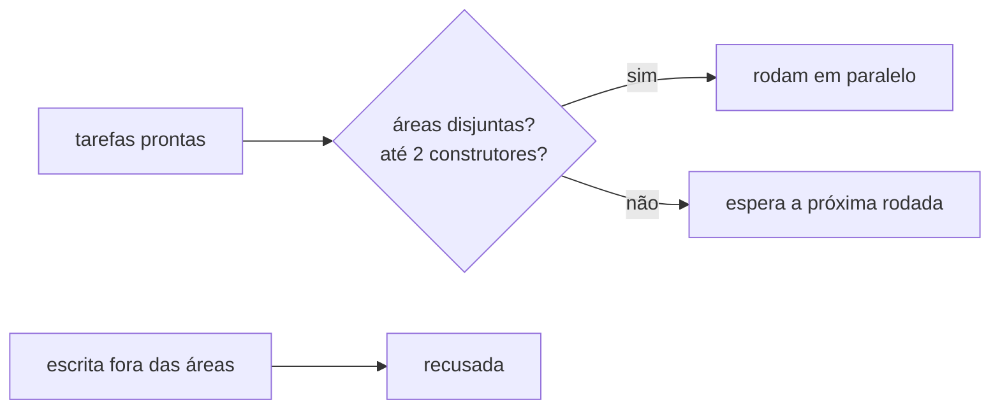

# FAB-503 · Parallel tasks without file contention

> ⬜ To do · Stage **E5 — Parallelism and fault tolerance** · Package 5.3 · Story · R6, R9

## The idea

Several tasks run at once, but two never touch the same file: each task's declared areas are checked before dispatching and inside the write tool.

## Overview



## What was done

Allows several tasks in parallel without two editing the same file. Each task's declared areas act as a mutex at two points: before dispatching and inside the write tool. The number of simultaneous agents follows the machine profile (8 GB).

## Why it exists

Guarantees R6 (safe parallelism) and R9 (fits the target machine): the rule belongs to the system, not to an instruction a badly written prompt could bypass.

## How it was built

- `Factory.Queue.Exclusion.batch/2` delegates to `Scheduler.next_steps/2` and re-checks the guarantees, raising if one breaks
- Rule: up to N builders with disjoint areas, verifier only on a quiet project, reviewer alongside anything
- `Factory.Queue.Exclusion.allow?/2` is called by `Factory.Tools.Files.write/4` and `edit/5`, which return `{:error, :outside_areas}`
- `all_disjoint?/1` checks the intersection file by file

**Example:** two tasks declaring `lib/a.ex` are never in the same batch, and an agent writing outside its areas is refused.

## Acceptance criteria

- [ ] Two tasks with overlapping areas never run together
- [ ] The in-flight limit comes from the machine profile

## How to verify

```bash
mix test test/factory/queue/exclusion_test.exs
```

## Where it lives in the code

`Factory.Queue.Exclusion` · `Factory.Tasks.Scheduler` · `Factory.Tools.Files`
