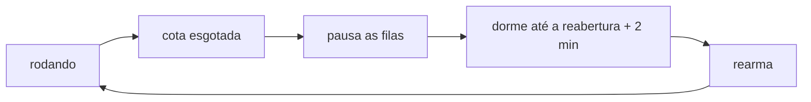

# FAB-504 · Recognise the provider usage limit and resume

> ⬜ To do · Stage **E5 — Parallelism and fault tolerance** · Package 5.4 · Story

## The idea

When the usage quota runs out the system does not treat it as a failure: it pauses the queues without cancelling anything, sleeps until the reopening time and resumes on its own.

## Overview



## What was done

Treats the subscription usage limit as a system state, not as the failure of one dispatch. When quota runs out, the system pauses the queues without cancelling anything, sleeps until the announced reopening time and resumes on its own.

## Why it exists

Under a subscription the scarce resource is quota, not money; without this, every quota wall would be judged as a rejection and burn cycles.

## How it was built

- The adapters turn the vendor response into `{:error, {:quota, reopens_at}}`
- `Factory.Quota.hit/2` pauses the Oban queues without touching `oban_jobs`
- A timer rearms at the reopening time + margin; without a readable time, capped exponential backoff
- `reopen_time/1` also accepts text like '5:30pm (America/Sao_Paulo)'
- The worker snoozes the dispatch that hit the wall instead of judging it

**Example:** at 2pm quota runs out with reopening at 5:30pm: queues pause, jobs stay `available`, and at 5:30pm + margin everything runs again.

## Acceptance criteria

- [ ] The quota wall is recognised from the structured event
- [ ] Queued work is not cancelled
- [ ] A dispatch that hit the wall is not judged as a rejection

## How to verify

```bash
mix test test/factory/quota_test.exs
```

## Where it lives in the code

`Factory.Quota`
