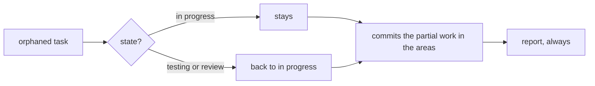

# FAB-505 · Recover interrupted work

> ⬜ To do · Stage **E5 — Parallelism and fault tolerance** · Package 5.5 · Story · R13

## The idea

After a crash, recovery finds tasks with no live agent, restores their state and commits, on behalf of each, the work left half-written.

## Overview



## What was done

Recovers interrupted work after a crash. It crosses the database (tasks in a transient state) with the Registry (live agents) and git (changed, uncommitted files), and commits partial work on behalf of the right task.

## Why it exists

Guarantees R13: nothing is lost silently. A gate that died left an unknown verdict, never a favourable one, so it goes back to execution.

## How it was built

- `Factory.Recovery.reconcile/1` finds tasks in `in_progress`/`in_testing`/`in_review` with no live agent (orphans)
- `in_progress` stays as it is (already dispatchable as builder); testing and review go back to `in_progress` with outcome `recovery`
- Uncommitted changes in the orphan's areas are committed through `Factory.Publishing.Git.commit/3`
- Always returns a report, even empty: a cleanup that only speaks when it finds something cannot be told apart from a broken one

**Example:** a dead builder left `c.txt` uncommitted; recovery commits the file with a message citing the task and 'recovery'.

## Acceptance criteria

- [ ] Recovery always reports, even with nothing to do
- [ ] Partial work is committed on behalf of the right task

## How to verify

```bash
mix test test/factory/recovery_test.exs
```

## Where it lives in the code

`Factory.Recovery`
