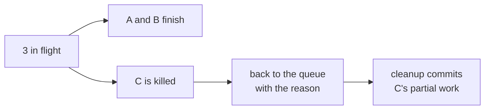

# FAB-506 · MILESTONE E5 — three in parallel, killing one does not bring down the others

> ⬜ To do · Stage **E5 — Parallelism and fault tolerance** · Package Milestone · Milestone · R6, R13

## The idea

The stage proof: three real agent processes running at once; one is killed mid-run, the other two finish, and the dead one returns to the queue losing nothing.

## Overview



## What was done

Stage 5 milestone: a permanent test with real processes in which three agents run at once, one is killed midway and the other two carry on. The killed task returns to the queue with a reason, and its partial work is recovered.

## Why it exists

Proves R6 and R13 through composition: supervisor, area exclusion, recovery and quota work together, not only each in its own suite.

## How it was built

- 1. `Queue.Exclusion.batch/2` releases 3 builders with disjoint areas; the Registry confirms all three in flight
- 2. A and B wait for a signal; C writes partial work to `c.txt` and hangs — and is killed with `stop_agent/1`
- 3. A and B reach `in_testing`; C returns to the queue with a reason, in `in_progress`, dispatchable as builder
- 4. No usage lost (1 row for A and B, 0 for C); `Recovery.reconcile/1` commits `c.txt` citing the task
- 5. Second test: an injected quota error pauses the queues, the job stays `available` and the rearm resumes

**Example:** after recovery the project's `git status` is empty: no ownerless file.

## Acceptance criteria

- [ ] `mix test test/factory/milestone_e5_test.exs` passes
- [ ] The killed task returns to the queue with a reason, without losing usage

## How to verify

```bash
mix test test/factory/milestone_e5_test.exs
```

## Where it lives in the code

`Factory.Agents.Supervisor` · `Factory.Queue.Exclusion` · `Factory.Recovery` · `Factory.Quota` · `Factory.Queue.Worker`
