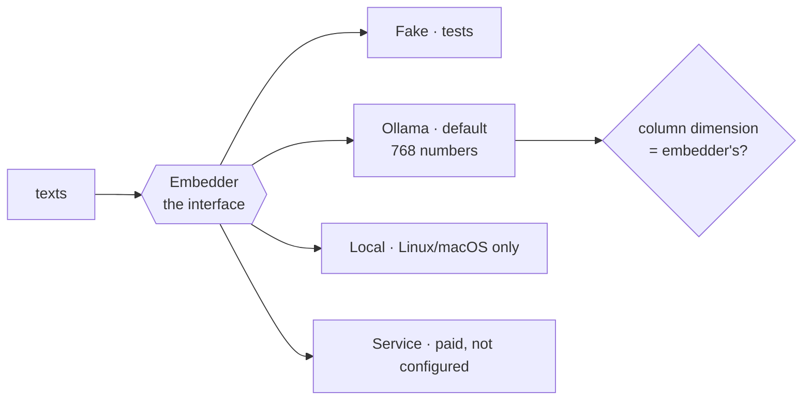

# FAB-601 · Measure before choosing where search runs

> ⬜ To do · Stage **E6 — Project memory** · Package 6.1 · Spike · R9

## The idea

Measure before choosing where text becomes a vector: the in-Elixir model is heavy and has no acceleration on Windows, so the default became local Ollama, and the column dimension is now checked against the embedder.

## Overview



## What was done

Spike to choose where memory embeddings are generated: an in-process local model, a local Ollama server or a paid service. It measured memory and time and picked Ollama with `embeddinggemma` as the default. The dimension of the database vector column is now checked against the configured embedder.

## Why it exists

Contributes to R9 (runs on an 8 GB machine): embedding is the only heavy piece of the design, and the choice was made from measured numbers.

## How it was built

- `Factory.Embedder.Ollama` (default): different prefixes for documents and queries, required by `embeddinggemma`
- `Factory.Embedder.Local` (Bumblebee): ~220 MB resident; no EXLA binary on Windows, so only behind `FACTORY_EMBEDDER_LOCAL=1`
- `Factory.Embedder.Service`: HTTP to an external service, left unconfigured
- `Factory.Memory.Dimension.check/0` compares the `chunks.embedding` column with the embedder; `align!/0` fixes it
- Every returned vector is checked: a wrong dimension becomes `{:error, {:invalid_dimension, ...}}`

**Example:** switching from a 384- to a 768-dimension embedder is detected by `check/0` before any write.

## Acceptance criteria

- [ ] Decision recorded with the measured numbers
- [ ] Local embedding adapter working
- [ ] Index dimension follows the configured embedder

## How to verify

```bash
mix test test/factory/embedder/ollama_test.exs
mix test test/factory/embedder/service_test.exs
mix test test/factory/memory/dimension_test.exs
mix run priv/probes/ollama_real.exs
```

## Where it lives in the code

`Factory.Embedder.Ollama` · `Factory.Embedder.Local` · `Factory.Embedder.Service` · `Factory.Memory.Dimension`
