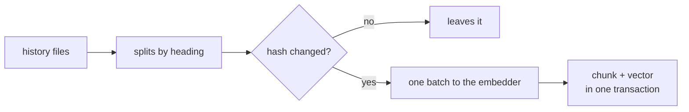

# FAB-602 · Store history as searchable chunks

> ⬜ To do · Stage **E6 — Project memory** · Package 6.2 · Story

## The idea

The project history is cut by section and stored with each chunk's vector; only what is new or changed pays for embedding.

## Overview



## What was done

Memory ingestion: splits the project history (decisions, review findings, verification reports, finished tasks) into chunks by markdown section and stores each chunk with its embedding. It does not index code — the dense index already does that.

## Why it exists

Gives the agent access to what was already decided in the project at low cost: only new or changed chunks are reprocessed.

## How it was built

- `Factory.Memory.Ingestion.split/1` cuts at every `#`..`######` heading, never inside a code block
- `process/3` compares each chunk's sha256 (`Factory.Memory.Chunk.hash/1`) and only embeds what changed
- All new chunks of one pass go in a single `embed/1` call
- `source` identifies file and section, e.g. `_management/DECISIONS.md#6.2`
- Which files go in is the caller's decision; at this stage nothing triggers ingestion on its own — the tests are the caller

**Example:** re-ingesting the same unchanged `DECISIONS.md` creates no new chunk.

## Acceptance criteria

- [ ] Each history section becomes a searchable chunk
- [ ] Re-ingesting the same content does not duplicate chunks

## How to verify

```bash
mix test test/factory/memory/ingestion_test.exs
```

## Where it lives in the code

`Factory.Memory.Ingestion` · `Factory.Memory.Chunk`
