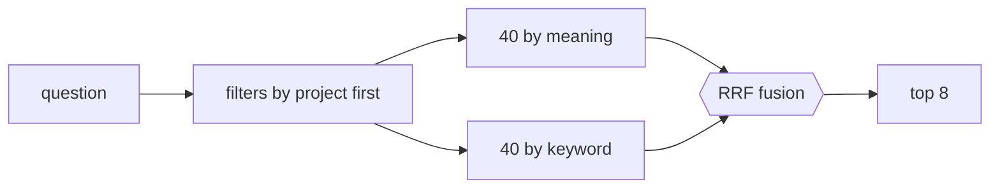

# FAB-603 · Search by meaning and by exact term

> ⬜ To do · Stage **E6 — Project memory** · Package 6.3 · Story

## The idea

Two searches in the same project — by meaning and by exact word — fused by rank: each covers what the other misses.

## Overview



## What was done

Searches project memory in three modes: by meaning (vector), by exact term (Postgres full text) and hybrid, which fuses both rankings with Reciprocal Rank Fusion. Hybrid is the default, chosen by measurement.

## Why it exists

Vectors miss proper names (like an option name) and text search misses synonyms; each covers the other's gap.

## How it was built

- `Factory.Memory.Search.search/3` with `mode: :vector | :text | :hybrid`; each mode is a single SQL statement
- A `MATERIALIZED` CTE filters by `project_id` BEFORE vector distance, so the HNSW index does not return fewer results
- The term is embedded as a QUERY (`Factory.Embedder.embed_query/2`), not as a document
- Measured: recall@8 hybrid 0.667, vector 0.619, text 0.048

**Example:** a search for `--require` finds the right decision through text, even though the embedding does not know what the option means.

## Acceptance criteria

- [ ] Hybrid, vector and text modes available
- [ ] The project filter does not lose chunks in the approximate index

## How to verify

```bash
mix test test/factory/memory/search_test.exs
```

## Where it lives in the code

`Factory.Memory.Search`
