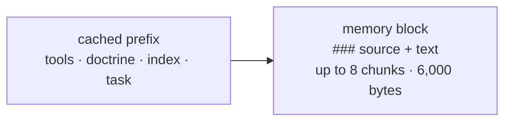

# FAB-604 · Deliver context with its source cited

> ⬜ To do · Stage **E6 — Project memory** · Package 6.4 · Story · R7

## The idea

The best chunks become a block where each one cites its source, placed after the part of the prompt the cache reuses.

## Overview



## What was done

Builds the retrieved-context block: the best chunks of the project history, each citing its source, to attach to the agent's dispatch. The block goes after the cached part of the prompt, and with no chunks the prompt is unchanged.

## Why it exists

Prepares R7 (the agent uses project memory with sources): the citation lets anyone check where the information came from, and the position preserves the cache.

## How it was built

- `Factory.Memory.Context.build/3` searches and caps at `max_chunks/0` chunks and `max_bytes/0` bytes
- Cuts are always whole chunks from the end of the list; the first (most relevant) is always included
- `format/1` writes each chunk's source; `append/2` only concatenates to the prefix, never alters it
- At this stage no dispatch calls the block; in E7 `Factory.Dispatch.build/4` appends it by default (`memory: false` turns it off)

**Example:** a chunk shows up as `### _management/DECISIONS.md#6.2 — the database is the truth`, followed by its text.

## Acceptance criteria

- [ ] The block cites each chunk's source
- [ ] With no chunks, the prompt is unchanged
- [ ] The block stays outside the cached band

## How to verify

```bash
mix test test/factory/memory/context_test.exs
```

## Where it lives in the code

`Factory.Memory.Context`
