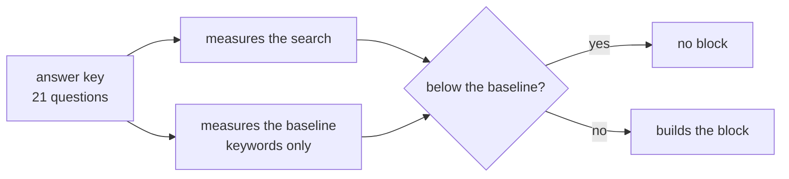

# FAB-605 · Evaluate search quality

> ⬜ To do · Stage **E6 — Project memory** · Package 6.5 · Story

## The idea

An answer key of questions with known answers measures search; if it falls below keyword-only search, the memory block is switched off.

## Overview



## What was done

Evaluates search quality with a fixed set of questions with known answers, over a sample history corpus. It computes recall@8, recall@1 and MRR for each mode, and switches the memory block off when search falls below the baseline.

## Why it exists

Bad memory is worse than none: wrong context leads the agent to decide wrongly with confidence. The measurement also justifies hybrid as the default mode.

## How it was built

- `Factory.Memory.Evaluation` (in `priv/evaluation/questions.exs`) holds the answer key of questions and expected answers
- Test corpus in `test/support/fixtures/evaluation_corpus/` (decisions, guide, progress, tasks)
- `measure_all_modes/2` measures the three modes; `baseline/2` is the keyword-only baseline
- `build_safe_context/3` switches the block off when `below_baseline?/2` is true or search errors

**Example:** if recall@8 drops below the baseline, the dispatch goes out with no memory block instead of irrelevant chunks.

## Acceptance criteria

- [ ] Metrics computed over the evaluation set
- [ ] Below baseline, the block is not sent

## How to verify

```bash
mix test test/factory/memory/evaluation_test.exs
```

## Where it lives in the code

`Factory.Memory.Evaluation` · `Factory.Memory.Search` · `Factory.Memory.Context`
