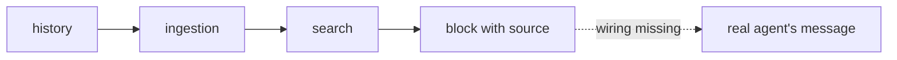

# FAB-606 · MILESTONE E6 — the agent cites the earlier decision

> ⬜ To do · Stage **E6 — Project memory** · Package Milestone · Milestone · R7

## The idea

Watch a real agent cite the earlier decision with the right source. The pieces exist and are tested; memory still has to reach the agent's message.

## Overview

## What was done

Stage 6 milestone, NOT YET ACHIEVED (blocked): the memory pieces exist and are tested, but memory does not yet reach the real agent's message.

## Why it exists

It would prove R7 with the real model. It is blocked because memory does not yet reach the message the real agent receives.

## How it was built

- In E6, no dispatch code calls memory, and ingestion is not triggered on its own
- In E7, `Factory.Dispatch.build/4` appends the block to the prefix text (`prefix.text`)
- But `Factory.Queue.Worker` builds the message from the bands only (`prefix.blocks`), dropping the text that carries memory
- To unblock: the queue uses the full text, ingestion is triggered, and a real agent runs a task whose answer is in an earlier decision
- No files have been delivered for this milestone

## Acceptance criteria

- [ ] A real agent cites the decision with its source
- [ ] Blocker: memory does not reach the real agent's message yet

## Where it lives in the code

`Factory.Memory.Context` · `Factory.Queue.Worker` · `Factory.Dispatch (E7)`
