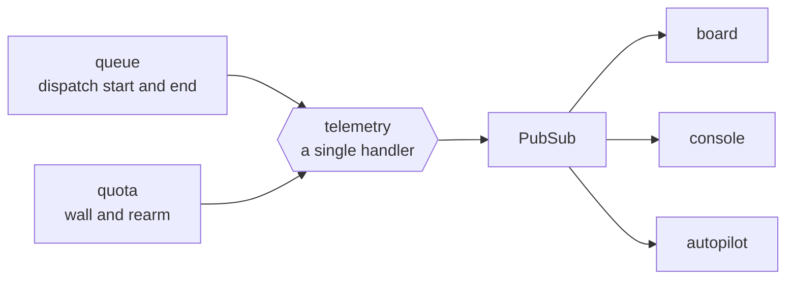

# FAB-701 · Per-run measurements

> ⬜ To do · Stage **E7 — Dashboard and automation** · Package 7.1 · Story

## The idea

The engine announces what it does through named events, and whoever needs to know — the screen, the autopilot — listens, without the engine knowing who is listening.

## Overview



## What was done

Creates the engine's event bus: start and stop of each dispatch, each turn (tokens and cost), task state changes and quota hit/rearm. Anyone interested listens to these events (screens, autopilot) without touching the engine.

## Why it exists

Accounting does not depend on someone remembering to record it, and the UI reads exactly the events the engine produces.

## How it was built

- `Factory.Events` emits through `:telemetry.execute/3` (`dispatch_start/1`, `dispatch_turn/2`, `dispatch_stop/1`, `task_transition/1`, `quota_hit/1`, `quota_rearm/0`)
- `Factory.Telemetry.attach/0`, called at application boot, attaches a single handler that forwards each event to Phoenix.PubSub
- Subscribers use `Factory.Events.subscribe/0`
- On the real path dispatch start/stop (queue) and quota hit/rearm (quota) are already emitted. Turn and state-change events are declared, but the agent loop and `Transition` do not emit them yet — today only the tests and the Stop button produce them

**Example:** at the end of each dispatch the queue publishes `[:factory, :dispatch, :stop]` with the number of turns and the spend; that event is what makes the autopilot start the next round.

## Acceptance criteria

- [ ] Every dispatch emits start and end with its cost
- [ ] The screen reads the same events as the engine

## How to verify

```bash
mix test test/factory/events_test.exs
```

## Where it lives in the code

`Factory.Events` · `Factory.Telemetry`
