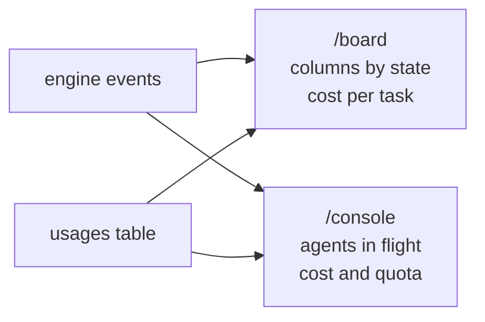

# FAB-702 · Live task board and console, with cost

> ⬜ To do · Stage **E7 — Dashboard and automation** · Package 7.2 · Story · R8

## The idea

Two pages that update themselves from the engine's events: the board shows which state each task is in and what it cost; the console shows who is running right now.

## Overview



## What was done

Creates the two live web screens (Phoenix LiveView): a project's task board, grouped by pipeline state and with each task's cost, and the console, showing agents in flight, the selected agent's turns, cost per task and the quota wall.

## Why it exists

Guarantees R8 (follow the work in real time with cost): the operator sees what is happening without querying the database or logs.

## How it was built

- `FactoryWeb.BoardLive` (`/board`) subscribes to `Factory.Events` and reloads when a state-change event arrives — no polling
- `FactoryWeb.ConsoleLive` (`/console`) lists agents in flight through `Factory.Agents.Supervisor.list/0`, with a periodic refresh
- Cost per task summed from `Factory.Tasks.Usage`, showing input / cache write / cache read / output
- Quota wall followed through the `quota hit`/`rearm` events
- Current limit: since state-change and turn events are not emitted on the real path yet, the board and the costs refresh when the page opens; live, for now, are only the agents in flight and the quota

**Example:** in the test, a state-change event moves the card to another column on the board without a page reload.

## Acceptance criteria

- [ ] The board updates by itself when a task changes state
- [ ] The console shows agents in flight, cost per task and the quota

## How to verify

```bash
mix test test/factory_web/live/board_live_test.exs
mix test test/factory_web/live/console_live_test.exs
```

## Where it lives in the code

`FactoryWeb.BoardLive` · `FactoryWeb.ConsoleLive`
