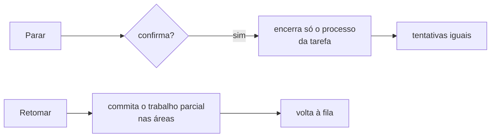

# FAB-703 · Stop and resume

> ⬜ To do · Stage **E7 — Dashboard and automation** · Package 7.3 · Story

## The idea

Interrupting an agent must not cost work or punish the task: stop kills only that process and spends no cycle; resume keeps what was done and puts the task back in the queue.

## Overview



## What was done

Creates the UI component with a task's Stop and Resume buttons. Stop kills only that task's supervised process; Resume returns it to the queue, first committing the partial work done in its areas. The component is tested but not yet placed on any page.

## Why it exists

Gives human control without losing work and without penalising the task: an operator stop never spends a cycle.

## How it was built

- `FactoryWeb.Components.Controls` composes two already-tested mechanisms
- Stop = `Factory.Agents.Supervisor.stop_agent/1` + an event with reason `:stopped_by_operator`, without going through `Transition`
- Resume = `Factory.Recovery.reconcile/1` scoped to ONE task
- Stop asks for confirmation (`request_stop` → `confirm_stop`)
- It still has to be mounted on the board or the console: today only the test renders it

**Example:** stopping task 7 leaves tasks 5 and 6 untouched, and task 7's attempts counter stays the same.

## Acceptance criteria

- [ ] Stopping ends only the chosen process
- [ ] A stopped task can be resumed

## How to verify

```bash
mix test test/factory_web/controls_test.exs
```

## Where it lives in the code

`FactoryWeb.Components.Controls` · `Factory.Agents.Supervisor` · `Factory.Recovery`
