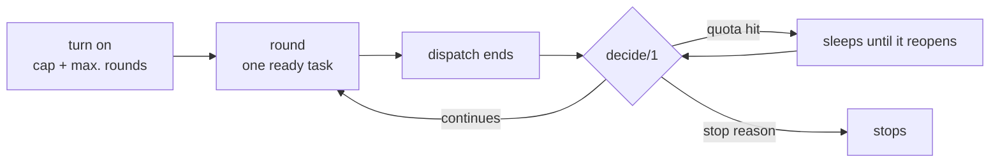

# FAB-704 · Automatic rounds with a spending ceiling

> ⬜ To do · Stage **E7 — Dashboard and automation** · Package 7.4 · Story

## The idea

Chain rounds on its own, but only with two mandatory brakes — a spend cap and a maximum number of rounds — and with the decision written as an ordered table of rules, tested case by case.

## Overview



## What was done

Creates the autopilot: chains work rounds on its own until a stop criterion. Enabling it requires two brakes — a total spend cap and a maximum number of rounds — and the continue/sleep/stop decision is a tested pure function.

## Why it exists

Allows unattended operation with bounded spend. Disabling never cuts work in flight, because the decision is only consulted BETWEEN rounds.

## How it was built

- `Factory.Autopilot.Decision.enable/2` requires both brakes
- `decide/1` in fixed order: disabled → quota (sleep) → no task → replanning → 2 rounds finishing nothing → failure → spend cap → max rounds
- `Factory.Autopilot.Server.build_round/1` has no algorithm of its own: it composes `Exclusion.batch/2` (E5) with `Worker.dispatch/3`
- A round ends with the dispatch-stop event of the task the autopilot dispatched
- State persisted as JSON per project, survives restarts; `FactoryWeb.Components.Autopilot` is only the view, not yet placed on any page

**Example:** on a quota hit the autopilot sleeps until the reopening time and rearms, instead of counting the round as 'no progress'.

## Acceptance criteria

- [ ] The continue decision is a tested pure function
- [ ] Stops on ceiling, no work left or no progress
- [ ] Hitting the quota sleeps and re-arms instead of stopping

## How to verify

```bash
mix test test/factory/autopilot/decision_test.exs
mix test test/factory/autopilot/server_test.exs
```

## Where it lives in the code

`Factory.Autopilot.Decision` · `Factory.Autopilot.Server` · `FactoryWeb.Components.Autopilot`
