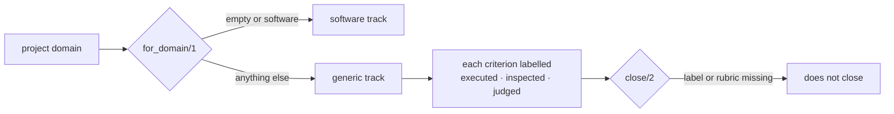

# FAB-705 · Non-code deliverables

> ⬜ To do · Stage **E7 — Dashboard and automation** · Package 7.x · Story

## The idea

Not every deliverable is code. The project's domain picks the track, and every criterion must state how it was proven — executed, inspected or judged — so that nothing is skipped silently.

## Overview



## What was done

Creates the generic track, for deliverables that are not code (presentation, document, data analysis). The project's domain picks the track, and every acceptance criterion must be labelled with a proof level: executed, inspected or judged.

## Why it exists

Outside software there is no free mechanical proof; the mandatory label stops the verifier from silently skipping a criterion it cannot prove.

## How it was built

- `Factory.Tracks.for_domain/1`: `nil` or `"software"` → `:software`; any other value → `:generic`
- Roles (builder, verifier, reviewer) are the same; only the agent serving each changes (`agent/2`)
- `Factory.Criteria.ProofLevel.close/2` refuses to close without a label on every criterion
- `:judged` requires a rubric of binary items in the task; `judged_ratio/1` measures how much of a project rests on judgement
- Rules ready and tested; the queue does not consult them yet (today every project follows the software track)

**Example:** in a project with domain `presentation`, a 'readable slides' criterion with no command only closes as `[judged]` if the task has a rubric.

## Acceptance criteria

- [ ] The project domain selects the track
- [ ] Every criterion is labelled: executed, inspected or judged

## How to verify

```bash
mix test test/factory/tracks_test.exs
```

## Where it lives in the code

`Factory.Tracks` · `Factory.Criteria.ProofLevel`
