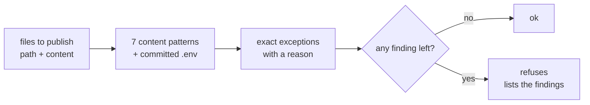

# FAB-706 · Secret scanning before publishing

> ⬜ To do · Stage **E7 — Dashboard and automation** · Package 7.5 · Story

## The idea

A leaked secret stays in git history forever; that is why the scan refuses instead of warning, and every exemption needs a written file, excerpt and reason.

## Overview



## What was done

Scans content about to be committed or published for API keys and credentials, and refuses when it finds one. Known false positives are cleared one by one, with a recorded reason. The rule is ready and tested; the automatic commit does not call it yet.

## Why it exists

The system commits on its own; a leaked secret stays in git history and is practically irreversible — so here the rule refuses instead of just warning.

## How it was built

- `Factory.Security.scan/1` takes a `{path, content}` list and returns `:ok` or `{:refused, findings}` — no third shape
- `patterns/0` lists the patterns: Anthropic, OpenAI, AWS, Google and GitHub keys, private key, password in a connection URL and a committed `.env` file
- `allowed/0` forgives only the exact finding (file, pattern, excerpt, reason), never a whole pattern
- The module does not read the disk or decide what gets committed; the caller passes the content — and it still has to be wired into the commit (`Factory.Publishing.Git`)

**Example:** a file containing something shaped like `sk-ant-...` comes back as `{:refused, [...]}`, while `.env.example` passes as a template.

## Acceptance criteria

- [ ] A known secret in content to be published is refused
- [ ] A common false positive does not block

## How to verify

```bash
mix test test/factory/security_test.exs
```

## Where it lives in the code

`Factory.Security`
