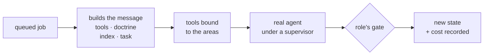

# FAB-707 · The real agent end to end

> ⬜ To do · Stage **E7 — Dashboard and automation** · Package Integration · Story

## The idea

Bring the pieces together on the real path: the queue takes the task, builds the message with the role's doctrine, hands out tools bound to the areas, starts the agent and applies the role's gate to the result.

## Overview



## What was done

Wires every piece into the real path: the agent's dispatch is now assembled from the task and each role's written doctrine (builder, verifier, reviewer), and the queue starts the real agent with its tools, records the result and applies the gates. Includes `mix factory.syntax`, which checks an Elixir file's syntax without running it.

## Why it exists

Closes the loop end to end: without this integration each mechanism worked in isolation in tests, but no real agent went through all of them.

## How it was built

- `Factory.Dispatch.build/4` assembles the four prefix bands (tools, doctrine, index, task) from the real task
- Role doctrines in `priv/doctrine/builder.md`, `verifier.md` and `reviewer.md`
- `Factory.Agents.Tools.build/4` binds each catalog name to the real function, bound to the task root and areas
- `Factory.Queue.Worker.perform/1` starts `Agents.Loop` under the supervisor and judges by role; a quota hit puts the same job back in the queue without spending an attempt
- Known limit: the dispatch appends the memory block to the text, but the queue builds the message from the bands only — the block does not reach the agent (this is what holds the E6 milestone)
- Known, declared risk: the `run` tool can call `git` directly, bypassing the area-scoped commit

**Example:** `mix factory.syntax priv/probes/confinement_cli.exs` confirms that a probe which would spend quota at least parses, without running it.

## Acceptance criteria

- [ ] Builder, verifier and reviewer each have a doctrine
- [ ] The queue dispatches the real agent and stores the result
- [ ] Syntax check without executing the file

## How to verify

```bash
mix test test/factory/dispatch_test.exs
mix test test/factory/agents/tools_test.exs
mix test test/mix/syntax_test.exs
mix test test/factory/queue/worker_test.exs
```

## Where it lives in the code

`Factory.Dispatch` · `Factory.Agents.Tools` · `Factory.Queue.Worker` · `Mix.Tasks.Factory.Syntax`
