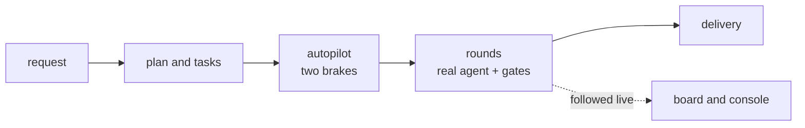

# FAB-708 · MILESTONE E7 — a whole project, no intervention, followed on screen

> ⬜ To do · Stage **E7 — Dashboard and automation** · Package Milestone · Milestone · R8

## The idea

The thesis's final proof: a whole test project, from request to delivery, driven by the autopilot under a spending cap and followed on screen — not yet executed.

## Overview

## What was done

Stage 7 milestone, IN PROGRESS (not yet achieved): run a whole test project, from request to delivery, with a single human intervention (the request), a spending ceiling and cost followed on screen. That run has not been executed yet.

## Why it exists

It would prove R8 and the thesis as a whole: the system drives a real project on its own, under rules that live in the code.

## How it was built

- Planned path: `mix factory.plan` creates the tasks → autopilot (`Factory.Autopilot.Server`) chains rounds
- Followed on `FactoryWeb.BoardLive` and `FactoryWeb.ConsoleLive`, with the cap in `Factory.Autopilot.Decision`
- Pending: wire the state-change and turn events, so the screen follows live
- Pending: mount the autopilot and Stop/Resume components on a page
- Pending: the queue sending the memory block (unblocks FAB-606)
- Pending: authorisation of the spending cap for the real run, which spends quota
- No files have been delivered for this milestone

## Acceptance criteria

- [ ] Test project completed with no intervention
- [ ] Pending: open fixes and spending-ceiling authorisation

## Where it lives in the code

`Factory.Autopilot.Server` · `Factory.Autopilot.Decision` · `FactoryWeb.BoardLive` · `FactoryWeb.ConsoleLive` · `Mix.Tasks.Factory.Plan`
