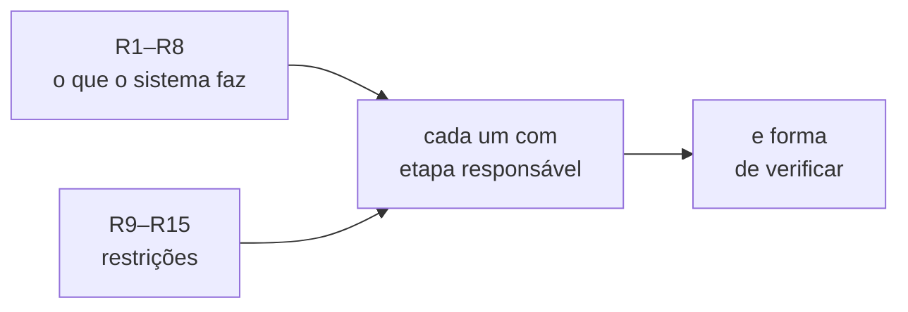

# FAB-101 · Levantar os requisitos R1–R15

> ✅ Concluída · Etapa **E1 — Planejamento e arquitetura** · Pacote 1.1 · Documento

## A ideia

Escrever, antes de programar, o que o sistema precisa fazer e sob que restrições — e, para cada item, qual etapa o entrega e como se prova. Sem isso, "pronto" seria opinião.

## Visão geral

## O que foi feito

Lista do que o sistema precisa fazer (8 requisitos funcionais) e das restrições sob as quais precisa funcionar (7 requisitos não funcionais). Cada requisito diz em que etapa será atendido e como será verificado.

## Por que existe

Sem requisitos com forma objetiva de verificação, nenhuma etapa teria critério de pronto; eles amarram cada entrega do cronograma a algo que pode ser testado.

## Como foi feito

- R1–R8: do pedido às tarefas, seis estados, dois julgamentos, retrabalho limitado, paralelismo, memória e acompanhamento ao vivo
- R9–R15: 8 GB de memória, custo em duas unidades, confinamento, testes sem internet, isolamento de falhas, teto de gasto, fornecedor trocável
- Cada linha traz a etapa responsável (E2–E7) e o teste que prova o requisito

**Exemplo:** R11 — 'nenhum agente escreve fora da pasta do projeto' — é provado na E3 por testes que tentam escapar da pasta e são recusados.

## Critérios de aceite

- [x] 15 requisitos escritos, cada um com etapa responsável
- [x] Cada requisito tem uma forma objetiva de verificação

## Como verificar

- `docs/planejamento/requisitos.md`

## Commits

- docs: add requirements R1-R15 (FAB-101)
