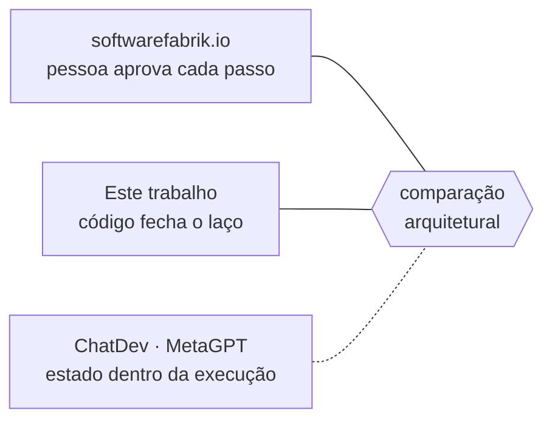

# FAB-102 · Estudar o estado da arte

> ✅ Concluída · Etapa **E1 — Planejamento e arquitetura** · Pacote 1.2 · Documento

## A ideia

Comparar este trabalho com os sistemas multi-agente que já constroem software, olhando a arquitetura e não a lista de recursos, para deixar claro onde está a contribuição.

## Visão geral

## O que foi feito

Comparação arquitetural com os sistemas multi-agente que constroem software, com destaque para o mais próximo, e o que este trabalho faz de diferente.

## Por que existe

Delimita a originalidade: a contribuição não é 'usar agentes', e sim mover as regras de governança do texto do pedido para a estrutura do programa.

## Como foi feito

- Quatro sistemas comparados pela arquitetura, não por recursos: ChatDev, MetaGPT, softwarefabrik.io e este trabalho
- Diferenças centrais: dois portões com perguntas diferentes, autoridade como ausência de ferramenta, escada de resposta à falha

## Critérios de aceite

- [x] Comparativo com os principais sistemas multi-agente
- [x] Relatório de originalidade

## Como verificar

- `docs/planejamento/estado-da-arte-resumo.pdf`
- `docs/planejamento/estado-da-arte-completo.pdf`

## Commits

- docs: add state-of-the-art comparison (FAB-102)
