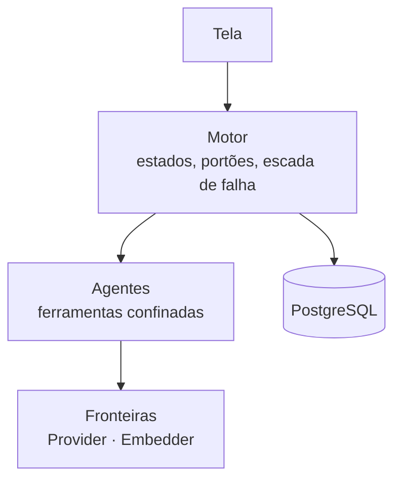

# FAB-103 · Desenhar a arquitetura

> ✅ Concluída · Etapa **E1 — Planejamento e arquitetura** · Pacote 1.3 · Documento

## A ideia

Desenhar o sistema de forma que cada regra de governança tenha um lugar no programa onde é imposta: a ação proibida não existe para o agente, em vez de ser só pedida no texto.

## Visão geral

## O que foi feito

Desenho do sistema: quatro camadas (tela, motor, agentes, fronteiras), o ciclo de vida da tarefa em seis estados com dois portões, a escada de resposta à falha e a pilha de tecnologia.

## Por que existe

É a arquitetura que torna as regras estruturais: cada regra tem um lugar no desenho onde ela é imposta, e não pedida.

## Como foi feito

- Diagramas das camadas e da máquina de estados (Mermaid, renderizados no GitHub)
- Tabela 'a regra × onde ela mora'
- Escolha do Elixir/OTP justificada pela supervisão de processos

## Critérios de aceite

- [x] Diagrama das 4 camadas e das fronteiras
- [x] Ciclo de vida da tarefa com 6 estados e 2 portões
- [x] Pilha escolhida e justificada

## Como verificar

- `docs/planejamento/arquitetura.md`

## Commits

- docs: add architecture: layers, task lifecycle and failure ladder (FAB-103)
