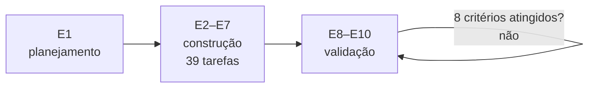

# FAB-104 · Dividir o trabalho e definir os critérios de desempenho

> ✅ Concluída · Etapa **E1 — Planejamento e arquitetura** · Pacote 1.4 · Documento

## A ideia

Transformar o desenho em um plano executável: etapas com entrega demonstrável, tarefas pequenas com critérios que são comandos, e uma régua numérica fixa para a validação.

## Visão geral

## O que foi feito

O plano de desenvolvimento (10 etapas em cascata), os 8 critérios de desempenho com limite numérico e o quadro de tarefas de E2 a E7, uma tarefa por pacote do plano.

## Por que existe

Os critérios são a régua da validação (E8–E10) e não mudam; o quadro de tarefas transforma cada etapa em entregas pequenas e verificáveis.

## Como foi feito

- Plano de desenvolvimento em Word
- 8 critérios: constrói sozinho, conclui tarefas, pouco retrabalho, não aprova errado, governa de verdade, aguenta falha, custo sob controle, cabe na máquina
- 39 tarefas de código distribuídas de E2 a E7

## Critérios de aceite

- [x] Backlog de E2–E7 escrito (este diretório)
- [x] 8 critérios de desempenho com limite numérico

## Como verificar

- `docs/planejamento/plano-de-desenvolvimento.docx`
- `docs/planejamento/criterios-de-desempenho.md`
- `docs/tasks/`

## Commits

- docs: add development plan, performance criteria and E2-E7 backlog (FAB-104)
