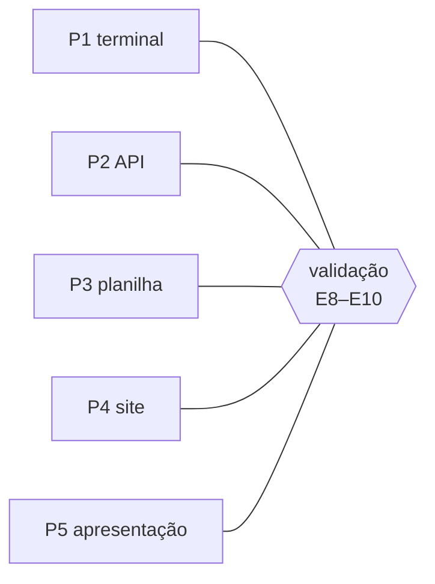

# FAB-105 · Definir os cinco projetos de teste

> 🔄 Em andamento · Etapa **E1 — Planejamento e arquitetura** · Pacote 1.4 · Documento

## A ideia

Escolher, antes de construir, os projetos reais em que o sistema será julgado — assim a régua não pode ser ajustada ao que o sistema consegue fazer.

## Visão geral

## O que foi feito

Proposta de cinco projetos reais, de tamanhos e tipos diferentes, que a validação vai executar do pedido à entrega sem intervenção humana.

## Por que existe

Os critérios de desempenho são medidos nesses projetos; escolhê-los antes da construção evita ajustar a régua ao sistema.

## Como foi feito

- P1 lista de tarefas em terminal · P2 API de biblioteca · P3 relatório a partir de planilha · P4 site de portfólio · P5 apresentação a partir de dados
- Cada projeto tem o pedido em linguagem natural e o que conta como entregue

**Exemplo:** Pendente: validar a proposta com o orientador.

## Critérios de aceite

- [ ] 5 projetos com pedido em linguagem natural
- [ ] Para cada um, o que conta como entregue

## Como verificar

- `docs/planejamento/projetos-de-teste.md`

## Commits

- docs: propose the five test projects (FAB-105)
